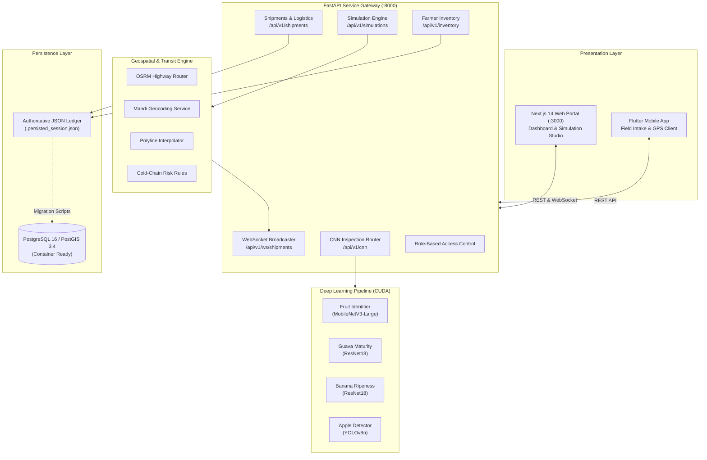

# AgriChain AI — Predictive Cold-Chain Agritech Exchange

[](https://fastapi.tiangolo.com)
[](https://nextjs.org)
[](https://pytorch.org)
[](https://python.org)
[](https://tailwindcss.com)
[](LICENSE)

**AgriChain AI** is an intelligent agricultural exchange and cold-chain integrity platform. It bridges harvest-level quality inspection with real-time transit logistics, cold-storage facility matching, and perishable goods market operations across northern Indian agricultural corridors (Punjab, Haryana, Rajasthan, and Uttar Pradesh).

---

## 1. Overview

Post-harvest losses in Indian horticultural produce often exceed 25% due to delayed mandi intake, inaccurate harvest maturity classification, and thermal excursions during highway transit. AgriChain AI addresses these systemic challenges through an integrated workflow:

1. **At the Farm Gate**: AI-driven visual maturity assessment and automated fruit identification classify produce (Guava, Banana, Apple) into actionable post-harvest classes.
2. **In Farmer Inventory**: Farmers register and manage batch stock, link batches to cold-storage facilities, and create dispatch lots.
3. **During Highway Transit**: Verified highway routes (via OSRM) calculate exact driving distances, travel durations, and step-by-step corridor waypoints across major transport arteries (NH-7, NH-9, NH-44, NH-52).
4. **Cold-Chain Monitoring**: Simulated reefer telemetry tracks real-time thermal boundaries (Guava: 4°C – 8°C; Banana: 13°C – 15°C) and calculates deterministic spoilage risk.
5. **In the Marketplace**: Dealers and B2B buyers verify batch freshness, audit facility provenance, and place reserve orders.

---

## 2. Main Features

- **AI-Based Fruit Quality Inspection**: Automated computer vision grading with crop-specialized backbones:
  - **Guava ResNet18**: 3-class harvest maturity grading (`Green`, `Mature Green`, `Ripe`) with 97.4% test accuracy.
  - **Banana ResNet18**: 4-class ripeness taxonomy (`Underripe`, `Barely Ripe`, `Ripe`, `Overripe`) with 98.1% accuracy.
  - **Apple YOLOv8n**: Object detection identifying fruit count and surface scab/rot lesions.
  - **Zero-Guesswork Fruit Identification**: MobileNetV3-Large pre-classifier routes produce to the correct model, rejecting foliage and out-of-distribution images.
- **Farmer Inventory Management**: Real-time stock registry, batch weight tracking, storage facility allocation, and one-click lot dispatch.
- **Role-Based Workspaces**: Tailored interfaces for 5 distinct stakeholders:
  - **Farmer Workspace**: Crop harvest intake, stock ledger, facility suitability checking.
  - **Logistics Workspace**: Real-time corridor map, highway polyline routing, vehicle simulation deck.
  - **Dealer Workspace**: Mandi intake lots, storage suitability verification, wholesale auctions.
  - **Buyer Workspace**: Freshness catalog, B2B marketplace ordering, proof-of-freshness records.
  - **Admin Workspace**: System telemetry, model registry, CUDA GPU device metrics, audit ledger.
- **Dynamic Road Routing**: OSRM-powered highway route resolution with vertex-by-vertex geometry and turn-by-turn distance calculations.
- **Virtual Vehicle Simulation**: Interactive simulation engine supporting discrete stepping (+15 km), multi-speed playback (1x, 2x, 5x, 10x), and highway traversal strictly along real road polylines.
- **Cold-Chain Telemetry HUD**: Live sensor gauges displaying reefer temperature, relative humidity, vehicle speed, compass heading, and traffic delay.
- **Rule-Based Spoilage-Risk Estimation**: Transparent, bounded risk scoring tracking temperature excursions (>8°C) and condensation humidity (>95%). *(Note: Currently rule-based and deterministic, not a trained LSTM model)*.

---

## 3. Technology Stack

- **Backend**: Python 3.13.7, FastAPI 0.142.2, Uvicorn, Pydantic v2, WebSockets
- **Deep Learning**: PyTorch 2.11.0+cu128, Torchvision 0.26.0, Ultralytics YOLOv8n, NVIDIA CUDA 12.8
- **Frontend**: Next.js 14.2.35 (React 18.3.1, Tailwind CSS 3.4.1), Leaflet, Lucide React
- **Mobile**: Flutter 3.x / Dart (Android scaffold in `apps/mobile`)
- **Geospatial & Routing**: OSRM Driving Engine, PostGIS (EPSG:4326 WGS84 coordinates)
- **Persistence**: Authoritative JSON State Ledger (`backend/app/db/.persisted_session.json`) with prepared PostgreSQL 16 / PostGIS 3.4 migration suite

---

## 4. Architecture



---

## 5. Repository Structure

```
Agritech/
├── .gitignore                      # Comprehensive Git exclusion rules
├── .gitattributes                 # Git LFS tracking for model weights (*.pth, *.pt)
├── .env.example                    # Root environment configuration template
├── README.md                       # Main project documentation
├── CONTRIBUTING.md                 # Contribution guidelines & branching model
├── package.json                    # Root workspace package manifest
├── start.bat                       # One-click Windows launch script (Backend + Frontend)
├── stop.bat                        # One-click service shutdown script
├── start_servers.ps1               # PowerShell startup script
├── stop_servers.ps1                # PowerShell shutdown script
├── apps/
│   ├── web/                        # Next.js 14 web application
│   │   ├── app/                    # App Router pages and dashboards
│   │   ├── components/             # React components (ShipmentsTracking, TrackingMap, etc.)
│   │   ├── lib/                    # API client, taxonomy constants, role configuration
│   │   └── package.json            # Web dependencies and scripts
│   └── mobile/                     # Flutter mobile client scaffold
│       ├── lib/                    # Dart screens and state management
│       ├── android/                # Native Android project configuration
│       └── pubspec.yaml            # Flutter package manifest
├── backend/                        # FastAPI application
│   ├── app/
│   │   ├── api/v1/endpoints/       # API routers (cnn, shipments, simulations, inventory, ws)
│   │   ├── core/                   # Configuration, security, geospatial utilities
│   │   ├── db/                     # Repository persistence & seed data
│   │   ├── models/                 # Domain entity models
│   │   ├── schemas/                # Pydantic request/response schemas
│   │   └── services/               # Routing, geocoding, CNN, and simulation engine
│   ├── requirements.txt            # Python backend dependencies
│   └── tests/                      # Pytest unit & integration test suites
├── database/                       # PostgreSQL / PostGIS migration suite
│   ├── migrations/                 # 001_initial_postgis_schema.sql through 005_...
│   └── apply_migrations.py         # Migration runner script
├── docs/                           # Technical documentation & phase reports
│   ├── PROJECT_ARCHITECTURE.md     # In-depth architectural specification
│   ├── DEVELOPMENT_SETUP.md        # Detailed setup and runbook
│   ├── MODEL_REGISTRY.md           # Model checkpoints cryptographic registry
│   ├── DATASET_SETUP.md            # Dataset acquisition and layout guide
│   └── KNOWN_LIMITATIONS.md        # Technical disclosures and limitations
├── ml/                             # Machine learning models & training pipeline
│   ├── artifacts/                  # Frozen model weights (tracked via Git LFS)
│   ├── configs/                    # Training hyperparameters & class taxonomies
│   ├── data/                       # Dataset manifests & directory structure
│   └── src/                        # Training and evaluation scripts
└── scripts/                        # Verification and regression test scripts
    ├── verify_simulation_route_integrity.py
    ├── verify_shipment_sync_and_map_focus.py
    ├── verify_shipment_routing.py
    └── audit_security.py
```

---

## 6. Installation & Setup

### 6.1 Prerequisites
- Python 3.10+ (Python 3.13.7 verified)
- Node.js v18+ (Node.js v22.19.0 verified)
- Git and Git LFS (`git lfs install`)

### 6.2 Clone and Pull Models
```bash
git clone https://github.com/prabhsandhujagirdaar-coder/Agritech.git
cd Agritech
git lfs pull
```

### 6.3 Backend Setup
```powershell
python -m venv .venv
.\.venv\Scripts\Activate.ps1
pip install torch torchvision --index-url https://download.pytorch.org/whl/cu128
pip install -r backend/requirements.txt
```

### 6.4 Frontend Setup
```bash
cd apps/web
npm install
cd ../..
```

### 6.5 Environment Setup
```powershell
Copy-Item .env.example .env
Copy-Item apps/web/.env.example apps/web/.env.local
```

---

## 7. Running Locally

### Option A: One-Click Startup (Recommended on Windows)
Simply double-click or run:
```cmd
.\start.bat
```
This automatically clears any stuck processes on ports 8000 and 3000 and opens two dedicated windows:
- **FastAPI Backend**: `http://127.0.0.1:8000` (Swagger UI: `http://127.0.0.1:8000/docs`)
- **Next.js Web Portal**: `http://localhost:3000`

To stop all services:
```cmd
.\stop.bat
```

### Option B: Manual Execution
**Terminal 1 — Backend**:
```powershell
$env:PYTHONPATH="backend"
.\.venv\Scripts\python.exe -m uvicorn app.main:app --host 127.0.0.1 --port 8000 --reload
```

**Terminal 2 — Frontend**:
```powershell
cd apps/web
npm run dev
```

---

## 8. Verification & Test Execution

Run the complete test and regression suites:

```powershell
$env:PYTHONPATH="backend"

# 1. Backend inventory unit tests
.\.venv\Scripts\python.exe backend/tests/test_inventory.py

# 2. Highway shipment routing test (4 corridors)
.\.venv\Scripts\python.exe scripts/verify_shipment_routing.py

# 3. Selected shipment auto-sync & map focus test
.\.venv\Scripts\python.exe scripts/verify_shipment_sync_and_map_focus.py

# 4. Simulation route integrity & corridor traversal test
.\.venv\Scripts\python.exe scripts/verify_simulation_route_integrity.py

# 5. Frontend unit tests & linter
npm --prefix apps/web test
npm --prefix apps/web run lint

# 6. Security & secrets audit
.\.venv\Scripts\python.exe scripts/audit_security.py
```

---

## 9. Current Limitations & Disclosures

For full details, see [`docs/KNOWN_LIMITATIONS.md`](docs/KNOWN_LIMITATIONS.md):
- **Rule-Based Spoilage Risk**: The thermal spoilage-risk estimator calculates transit degradation probabilities via cold-chain bounded deterministic rules and rolling sequence buffers rather than a trained LSTM neural network.
- **Active JSON State Ledger**: The application uses a robust local JSON state ledger (`.persisted_session.json`) for persistence. PostgreSQL / PostGIS migration scripts are prepared, but PostgreSQL is inactive by default in local demonstration mode.
- **Simulated Vehicle Telemetry**: GPS coordinates and sensor readings (`SNS-SIM-DEMO`) generated during simulation are mathematically interpolated along OSRM highway coordinates, representing virtual simulation rather than physical vehicle hardware.
- **Mobile Scaffold**: The Flutter mobile application (`apps/mobile`) is an early prototype scaffold. Full exchange capabilities are provided via the Next.js 14 web platform.

---

## 10. Project Status & Roadmap

| Module | Status | Technology |
| :--- | :---: | :--- |
| **Fruit Classification (Guava, Banana, Apple)** | **Production Ready** | PyTorch ResNet18 / YOLOv8n (CUDA) |
| **Fruit Identifier Pre-Classifier** | **Production Ready** | MobileNetV3-Large |
| **Shipment Logistics & Routing** | **Production Ready** | FastAPI + OSRM Highway Polylines |
| **Vehicle Simulation Engine** | **Production Ready** | Polyline Interpolator + Telemetry HUD |
| **Farmer Inventory Management** | **Production Ready** | Next.js 14 + JSON Ledger |
| **Role-Based Workspaces** | **Production Ready** | Farmer, Dealer, Buyer, Logistics, Admin |
| **PostgreSQL / PostGIS Relational DB** | **Schema Ready** | SQL Migrations 001–005 (Inactive in local demo) |
| **Mobile Client** | **MVP Scaffold** | Flutter 3.x (Android) |
| **Physical IoT Hardware Ingestion** | **Planned** | WebSocket `/api/v1/ws/shipments` integration |

---

## 11. License

This project is licensed under the MIT License. See [LICENSE](LICENSE) for details. Checkpoints and datasets retain their original academic and open-source licenses (CC BY 4.0 / CC BY-NC 4.0) as documented in [`docs/MODEL_REGISTRY.md`](docs/MODEL_REGISTRY.md).
