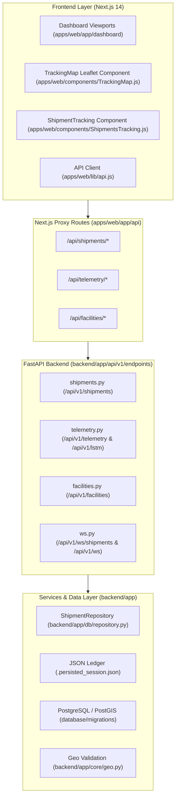
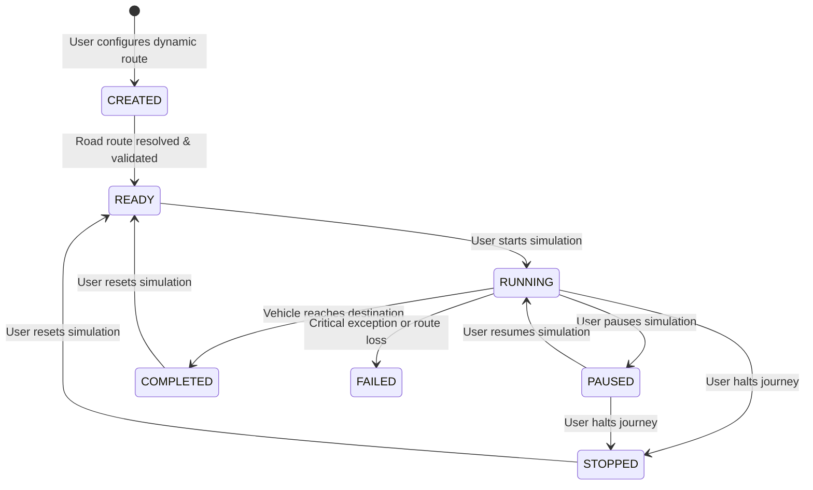

# AgriChain AI — Dynamic Real-Road Vehicle Simulation & Cold-Chain Intelligence
## Simulation Architecture Audit Report (Stage 1)

**Date**: November 1, 2026  
**Auditor**: Senior Backend Architect, Geospatial Engineer & ML Integration Specialist  
**System**: AgriChain AI — Predictive Cold-Chain Agritech Exchange  
**Scope**: Dynamic Real-Road Vehicle Simulation & Cold-Chain Intelligence Extension  

---

## 1. Executive Architecture Summary

The existing AgriChain AI platform incorporates:
- **FastAPI Backend (Python 3.13)**: Exposing REST endpoints for multi-fruit inspection, cold-chain telemetry ingestion, geospatial waypoints, APMC mandi suitability, and real-time WebSockets.
- **Next.js 14 Web Application (App Router)**: Client and server components utilizing Leaflet for map visualization, Tailwind CSS design system, and role-partitioned workspaces (Farmer, Logistics, Dealer, Buyer, Admin).
- **PostGIS 3.4 / PostgreSQL 16 Migration Assets**: Migrations `001` through `004` defining relational and spatial tables with SRID 4326 geometry and GIST indexes.
- **Authoritative JSON Persistence Ledger**: `backend/app/db/.persisted_session.json` providing atomic file persistence and transaction safety across backend reloads.
- **Cold-Chain Telemetry & Risk Contracts**: 24-step sequence evaluation based on temperature, humidity, delay minutes, speed, and distance remaining.
- **WebSocket Gateway**: `ConnectionManager` broadcasting real-time lifecycle and telemetry events.

This audit establishes the blueprint for extending AgriChain AI with a **production-quality server-authoritative vehicle simulation system** that navigates actual road networks between user-defined agricultural origins and destinations, without requiring physical trucks or GPS hardware.

---

## 2. Existing Modules & Reusability Audit

### 2.1 Reusable Components Identified

| Existing Module / File | Reusable Assets & Capabilities | Extension Role in Vehicle Simulation |
| :--- | :--- | :--- |
| `backend/app/api/v1/endpoints/ws.py` | `ConnectionManager`, `get_ws_manager()`, broadcast loop, keep-alive heartbeat | Used directly to broadcast simulation lifecycle events, interpolated vehicle positions, sensor readings, and LSTM risk scores. |
| `backend/app/api/v1/endpoints/telemetry.py` | `LSTMPredictionRequest`, `LSTMPredictionResponse`, `TelemetryPoint` (5 features) | Used as the contract for evaluating 24-step cold-chain spoilage risk during vehicle movement. |
| `backend/app/db/repository.py` | `ShipmentRepository`, `add_waypoint()`, `add_telemetry()`, `add_shipment_event()`, `_commit()` | Extended with additive methods to store and retrieve simulation sessions, road route polylines, and simulation telemetry. |
| `backend/app/schemas/telemetry.py` | `GeoWaypointRecord`, `GeoWaypointCreate`, `TelemetryPoint`, `LSTMPredictionRequest` | Integrated into simulation payloads to maintain 100% schema parity. |
| `backend/app/core/geo.py` | `is_within_india()`, `is_within_punjab_corridor()`, `WGS84_BOUNDS` | Ensures user-selected source/destination coordinates and interpolated route points remain valid geographic coordinates. |
| `apps/web/components/TrackingMap.js` | Leaflet map instance, OpenStreetMap tiles, layer management (`routeLayerRef`, `markersLayerRef`), custom SVG DivIcons | Enhanced with animated vehicle marker, road route polyline rendering, and map click-to-select handlers. |
| `apps/web/lib/api.js` | `fetchShipments()`, `fetchShipmentWaypoints()`, `evaluateLstmRisk()`, coordinate validation | Augmented with simulation session endpoints, geocoding search, and route preview functions. |

---

## 3. Required Modifications & Additive Enhancements

### 3.1 Files Requiring Modification (Additive / Non-Breaking)

1. `backend/app/main.py`:
   - Mount new `simulations.router` under `/api/v1/simulations` and compatibility `/api/simulations`.
   - Preserve all existing routes (`cnn`, `facilities`, `orders`, `shipments`, `telemetry`, `ws`).
2. `backend/app/api/v1/api.py`:
   - Include `simulations.router` in `api_router`.
3. `backend/app/db/repository.py`:
   - Add in-memory and ledger storage for `_simulation_sessions` and `_simulation_telemetry`.
   - Add methods: `create_simulation_session()`, `get_simulation_session()`, `update_simulation_session()`, `list_simulation_sessions()`, `add_simulation_telemetry()`, `get_simulation_telemetry()`.
   - Update `_commit()` to persist `simulation_sessions` in `.persisted_session.json`.
4. `apps/web/lib/api.js`:
   - Add client functions: `searchGeocoding()`, `previewRoadRoute()`, `createSimulation()`, `getSimulation()`, `startSimulation()`, `pauseSimulation()`, `resumeSimulation()`, `stopSimulation()`, `resetSimulation()`, `stepSimulation()`, `updateSimulationControls()`, `fetchSimulationTelemetry()`, `fetchSimulationHistory()`.
5. `apps/web/components/TrackingMap.js`:
   - Support rendering dynamic road route LineString (`#0284c7` solid road line).
   - Support animated vehicle marker positioned at the interpolated vehicle coordinate with heading rotation.
   - Support click-to-pick coordinates mode for source and destination.
6. `apps/web/components/ShipmentsTracking.js`:
   - Add dedicated "Dynamic Road Simulation" tab/modal.
   - Dynamic location search inputs (Nominatim geocoding autocomplete + map selection).
   - Real-time simulation control panel (Auto/Manual, Start, Pause, Resume, Stop, Reset, 1x/2x/5x speed multipliers, scenario selector).
   - Live telemetry HUD displaying speed, temperature, humidity, and real LSTM current/arrival risk.
   - Historical simulation replay player.

---

### 3.2 New Files Required

| New File Path | Purpose & Responsibilities |
| :--- | :--- |
| `backend/app/services/geocoding_service.py` | Geocoding service with rate-limited Nominatim provider, caching, and fallback Indian agricultural landmarks (farms, mandis, cold stores). |
| `backend/app/services/routing_service.py` | Road routing service connecting to OSRM (`/route/v1/driving`), returning true road LineString GeoJSON, distance in km, and duration in seconds. |
| `backend/app/services/simulation_engine.py` | Server-authoritative vehicle simulation engine: distance-based route interpolation, speed stepping, state machine, sensor scenario generation, rolling LSTM sequence evaluation, and WebSocket broadcasting. |
| `backend/app/api/v1/endpoints/simulations.py` | FastAPI endpoints for route preview, simulation session creation, lifecycle controls, telemetry queries, and history replay. |
| `backend/app/schemas/simulation.py` | Pydantic v2 schemas: `RoutePreviewRequest`, `RoutePreviewResponse`, `CreateSimulationRequest`, `SimulationSessionResponse`, `SimulationControlRequest`, `SimulationTelemetryRecord`. |
| `database/migrations/005_simulation_sessions_and_telemetry.sql` | Additive PostGIS migration creating `simulation_sessions` and `simulation_telemetry` tables with SRID 4326 geometries and spatial indexes. |
| `database/migrations/005_simulation_sessions_and_telemetry_rollback.sql` | Safe rollback migration for migration 005. |
| `apps/web/app/api/simulations/[...path]/route.js` | Next.js API proxy route forwarding simulation requests to FastAPI backend on port 8000. |
| `backend/tests/test_simulation_engine.py` | Comprehensive backend test suite verifying geocoding, OSRM road routing, vehicle interpolation, controls, LSTM integration, and WebSockets. |
| `scripts/verify_dynamic_simulation.py` | Automated end-to-end verification script testing complete road simulation and generating visual artifacts. |

---

## 4. Coordinate Reference Systems & Conventions

To prevent coordinate transposition errors between backend, routing providers, and frontend maps, the following strict standards are enforced:

| Subsystem | Coordinate Representation | Example |
| :--- | :--- | :--- |
| **OSRM Routing URL** | `{longitude},{latitude}` | `74.1994,30.1453;77.1772,28.7161` |
| **OSRM GeoJSON LineString** | `[[longitude, latitude], ...]` | `[[74.1994, 30.1453], [74.2105, 30.1520], ...]` |
| **PostGIS Geometry** | `ST_SetSRID(ST_MakePoint(longitude, latitude), 4326)` | `ST_MakePoint(74.1994, 30.1453)` |
| **Pydantic API Models** | Explicit fields: `latitude`, `longitude` | `{"latitude": 30.1453, "longitude": 74.1994}` |
| **Leaflet Map Rendering** | `[latitude, longitude]` | `L.marker([30.1453, 74.1994])`, `L.polyline([[30.1453, 74.1994], ...])` |

---

## 5. Machine Learning Integration Architecture (LSTM Risk Engine)

The simulation engine directly interfaces with the existing cold-chain spoilage model:
- **Input Shape**: $(1, 24, 5)$ representing a rolling 24-step history.
- **Ordered Features**:
  1. `temperature`: Generated by environmental scenario generator (bounded, produce-specific).
  2. `humidity`: Generated by environmental scenario generator (80%–95% RH for guava).
  3. `delay_minutes`: Cumulative traffic/hold delay.
  4. `speed_kmh`: Current vehicle ground speed along the road network.
  5. `distance_remaining_km`: Exact distance remaining along the road polyline.
- **Warm-Up / Buffer**: When the simulation starts, initial history is seeded with the origin baseline and physiological fluctuations until the 24-step rolling window is fully populated with live simulation readings.
- **Output**: `current_risk` ($0\text{--}100$), `predicted_arrival_risk` ($0\text{--}100$), `alert` ($\text{bool}$ if arrival risk $> 50.0$), `inference_ms`.
- **Broadcasting**: Evaluated at every position update and broadcast via `risk_update` and `telemetry_update` over the existing WebSocket gateway.

---

## 6. Simulation State Machine

- **Transitions**:
  - `CREATED` $\rightarrow$ `READY` on successful OSRM road geometry retrieval.
  - `READY` $\rightarrow$ `RUNNING` initiates the asyncio simulation loop.
  - `RUNNING` $\rightarrow$ `PAUSED` suspends time stepping while preserving elapsed distance and coordinates.
  - `RUNNING`/`PAUSED` $\rightarrow$ `STOPPED` terminates movement and flags the session.
  - `STOPPED`/`COMPLETED` $\rightarrow$ `READY` on reset: vehicle returns to source coordinate, telemetry history archived for replay.
  - Reaching $100\%$ route completion triggers `COMPLETED` exactly once.

---

## 7. Concurrency & Performance Strategy

1. **Lightweight Concurrency**:
   - Simulation loops are managed as non-blocking `asyncio.Task` instances on the FastAPI event loop, tracked by `simulation_id` in a thread-safe registry.
   - No external broker (Celery/Redis) is required, eliminating infrastructure bloat on the demonstration host.
2. **Rate Limiting & Caching**:
   - Geocoding queries to Nominatim are cached in-memory and throttled to conform to OpenStreetMap's 1 request/sec policy.
   - Road route geometry from OSRM is cached by coordinate pair hashes to prevent redundant network traffic.
3. **Graceful Network Degradation**:
   - If public OSRM is unreachable, the routing service falls back to a high-resolution offline Indian highway corridor waypoint router (using real NH-7/NH-9/NH-1 geocoordinates), ensuring demonstration reliability even in offline academic viva environments.

---

## 8. Definition of Done & Acceptance Gates

The implementation will be validated against:
1. **Dynamic Locations**: User enters custom source and destination; no hardcoded routes.
2. **True Road Following**: Vehicle traverses real highway polylines (not straight lines).
3. **Controls**: Start, Pause, Resume, Stop, Reset, and 1x/2x/5x speed multipliers verified.
4. **Authoritative GPS & Telemetry**: Backend calculates positions and sensor readings (`SNS-SIM-DEMO`).
5. **Real LSTM Inference**: 24-step sequence passed to risk engine, outputs broadcast over WebSocket.
6. **PostGIS & Storage Persistence**: Route geometry and waypoints stored with SRID 4326.
7. **Interactive UI & Replay**: Next.js dashboard features search autocomplete, animated vehicle, live HUD, and historical replay.
8. **Regression Stability**: Zero regression across all 109 backend tests, 5 frontend test suites, and 5 locked model checkpoints.

