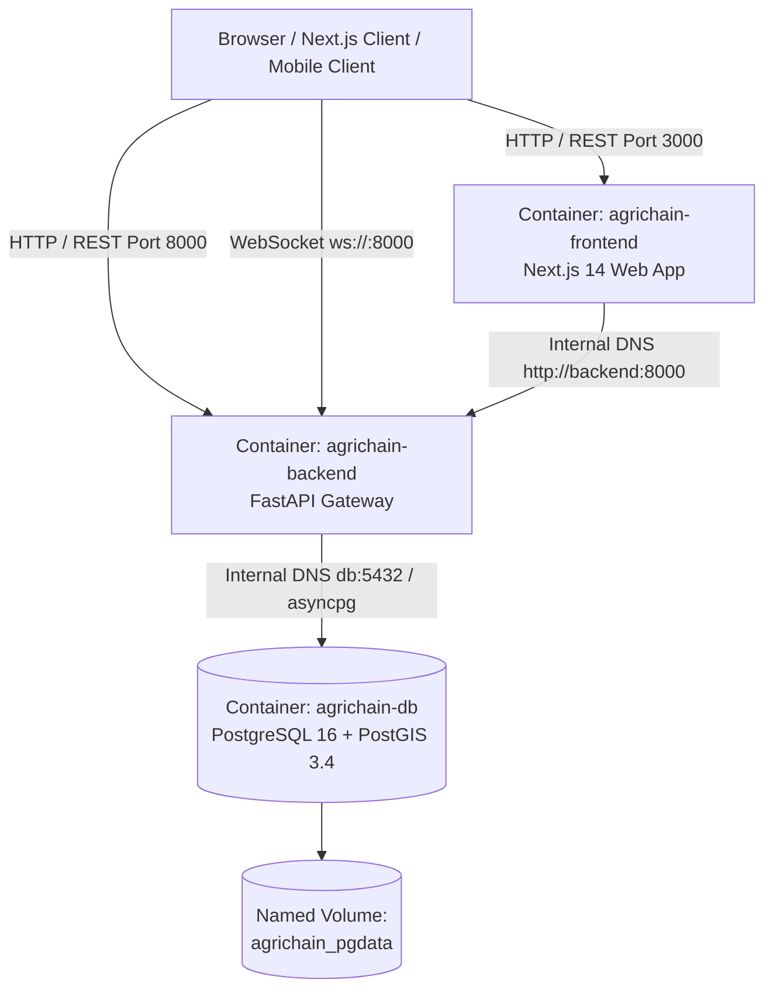

# AgriChain AI — Docker Operations, Architecture & Production Guide

## 1. System Architecture



---

## 2. Windows 11 PowerShell Operational Commands

All commands below are designed and tested for Windows 11 with PowerShell 5.1 / PowerShell 7+ and Docker Desktop.

### 2.1 Initial Setup
```powershell
# Navigate to repository root
Set-Location -Path "C:\Users\PrabSandhu\Documents\codes\Agritech_"

# Create local environment file from example template (if not already present)
if (-not (Test-Path .env)) { Copy-Item .env.example .env }
```

### 2.2 Building Container Images
```powershell
# Build both backend and frontend images
docker compose build

# Build with progress output and no cache (clean rebuild)
docker compose build --no-cache
```

### 2.3 Starting Services
```powershell
# Start all services in the background (detached)
docker compose up -d

# Verify all services are healthy (agrichain-db, agrichain-backend, agrichain-frontend)
docker compose ps
```

### 2.4 Monitoring & Logs
```powershell
# Stream logs for all services in real time
docker compose logs -f

# Stream logs for backend only
docker compose logs -f backend

# Stream logs for frontend only
docker compose logs -f frontend

# Stream logs for PostgreSQL/PostGIS database
docker compose logs -f db
```

### 2.5 Stopping and Restarting
```powershell
# Restart services without destroying containers or volumes
docker compose restart

# Stop all containers safely (preserves database data)
docker compose stop

# Resume stopped containers
docker compose start

# Tear down containers and networks (SAFE: preserves named volumes)
docker compose down
```

> [!CAUTION]
> **Never run `docker compose down -v`** unless you explicitly intend to permanently erase the PostgreSQL database volume (`agrichain_pgdata`). The `-v` flag deletes all persistent storage!

### 2.6 Database Inspections & PostGIS Queries
```powershell
# Connect directly to the database via psql inside the db container
docker compose exec db psql -U agrichain_user -d agrichain_db

# Query PostGIS version and extension confirmation
docker compose exec db psql -U agrichain_user -d agrichain_db -c "SELECT PostGIS_Version();"

# Inspect table rows (shipments, telemetry, waypoints)
docker compose exec db psql -U agrichain_user -d agrichain_db -c "SELECT id, produce_type, status FROM shipments;"

# Check spatial GiST indexes
docker compose exec db psql -U agrichain_user -d agrichain_db -c "SELECT indexname, indexdef FROM pg_indexes WHERE tablename='geo_waypoints';"
```

### 2.7 Automated Stack Verification
```powershell
# Run the automated live stack verification test suite
.\.venv\Scripts\python.exe scripts\verify_live_stack.py
```

---

## 3. Container Services & Network Design

| Service | Container Name | Image | Internal Port | Host Port | Health Check | Description |
| :--- | :--- | :--- | :--- | :--- | :--- | :--- |
| `db` | `agrichain-db` | `postgis/postgis:16-3.4` | 5432 | *Unexposed* | `pg_isready -U agrichain_user` | PostgreSQL with PostGIS extension for spatial queries. |
| `backend` | `agrichain-backend` | `agrichain-backend:1.0.0` | 8000 | 8000 | `curl -f http://localhost:8000/health` | FastAPI REST gateway, WebSocket server, ML inference service. |
| `frontend` | `agrichain-frontend` | `agrichain-frontend:1.0.0` | 3000 | 3000 | `wget -qO- http://127.0.0.1:3000/api/health` | Next.js 14 App Router dashboard with SSR and Leaflet map tracking. |

### Network Isolation
- All services communicate over the internal bridge network `agrichain-network`.
- The database port `5432` is intentionally **not published** to host interfaces to prevent unauthorized external access. Only containers attached to `agrichain-network` can reach the database.
- The backend communicates with `db:5432` using container DNS resolution.
- The frontend Next.js server actions communicate with `http://backend:8000` internally, while client-side browser JavaScript reaches `http://localhost:8000` or `NEXT_PUBLIC_API_URL`.

---

## 4. Machine Learning & Scientific Integrity in Docker

1. **Target Crop**: Kinnow Mandarin citrus (`Citrus reticulata`).
2. **Missing Checkpoint Behavior**: If `ml/artifacts/best_kinnow_resnet18.pth` is absent:
   - Root `/health` reports `status: degraded`, `model_available: false`.
   - `POST /api/v1/cnn/predict` returns **HTTP 503 Service Unavailable** with an explicit diagnostic message.
   - **No fake predictions or random labels are generated.**
3. **LSTM Telemetry Ingestion**:
   - `POST /api/v1/telemetry/predict` receives multi-step sequential telemetry (temperature, humidity, delay) and calculates the dynamic risk score and arrival risk prediction.

---

## 5. Troubleshooting & FAQ

### Issue: Port 8000 or 3000 Already in Use
**Symptom**: `Bind for 0.0.0.0:8000 failed: port is already allocated`.
**Resolution**: Check for lingering python/node processes on host:
```powershell
Get-NetTCPConnection -LocalPort 8000, 3000 -ErrorAction SilentlyContinue | Select-Object OwningProcess, LocalPort
# Stop the conflicting process:
Stop-Process -Id <PID> -Force
```

### Issue: Docker Compose fails to build Next.js due to symlinks on Windows
**Symptom**: `EPERM: operation not permitted, symlink ...`
**Resolution**: The production `Dockerfile` in `apps/web/` executes inside the Linux container filesystem, avoiding Windows NTFS symlink restrictions. Ensure the host `.dockerignore` excludes host `.next` and `node_modules` folders.

### Issue: Android Mobile Cannot Reach Backend
**Symptom**: Connection refused from Android app.
**Resolution**:
- If using **Android Emulator**: Set `API_BASE_URL` to `http://10.0.2.2:8000/api/v1`.
- If using **Physical Android Phone**: Set `API_BASE_URL` to your computer's LAN IP (e.g. `http://192.168.1.50:8000/api/v1`) and ensure port 8000 is permitted in Windows Firewall.
- Never use `http://backend:8000` inside Flutter (Docker service names do not resolve outside the Docker bridge network).
