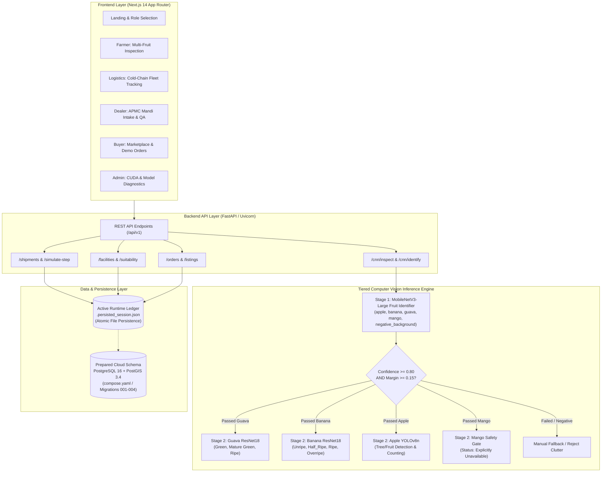
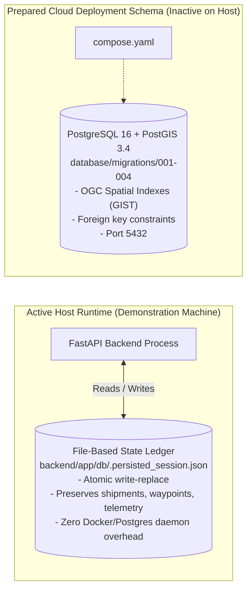

# AgriChain AI — Final Academic Viva Voce & Defense Guide

**Project Title**: AgriChain AI — Edge-to-Cloud Multi-Fruit Quality Inspection and Cold-Chain Traceability Platform  
**Academic Submission Deadline**: November 7, 2026  
**System Status**: Phase 20 Final Freeze Audit Complete — Production Locked & Verified  

---

## 1. Executive Summary & Architectural Overview

AgriChain AI is an end-to-end cyber-physical software platform designed to address post-harvest losses in Indian agricultural supply chains. The system combines:
1. **Tiered Edge Computer Vision**: Fast Stage-1 fruit taxonomy identification with specialized Stage-2 maturity classification and object detection.
2. **Post-Harvest Cold-Chain Logistics**: Geospatial transit monitoring adhering to OGC/PostGIS SRID 4326 standards and perishables thermal envelope enforcement (4°C – 8°C).
3. **Role-Shielded Stakeholder Workspaces**: Dedicated web interfaces for Farmers, Logistics Coordinators, Mandi Dealers, Institutional Buyers, and System Administrators.
4. **Resilient Dual-Mode Persistence**: An active atomic JSON file-based state ledger (`.persisted_session.json`) backed by containerized PostgreSQL 16 / PostGIS 3.4 relational migration schemas.

---

## 2. Deep Learning Computer Vision Models

### 2.1 The Case for a Hierarchical (Tiered) Architecture
A frequent panel inquiry is: *"Why did you not train a single monolithic convolutional neural network to classify all fruit classes and maturity stages simultaneously?"*

| Architectural Dimension | Monolithic Classifier | AgriChain AI Tiered Pipeline | Academic Justification |
| :--- | :--- | :--- | :--- |
| **Output Task Heterogeneity** | Single categorical classification. | Multi-task: Classification (Guava, Banana) + Object Detection (Apple). | Apples in orchard phenotyping require instance localization and counting; mature guavas require single-fruit harvest stage classification. Monolithic models cannot unify these objectives without architectural compromise. |
| **Out-of-Distribution (OOD) Clutter** | Prone to overconfident hallucinations on orchard foliage, hands, weeds. | Stage 1 features an explicit `negative_background` class + dual rejection thresholds. | Clutter and foliage are intercepted immediately at Stage 1, preventing corrupted maturity grading. |
| **Domain Decoupling & Modular Lifecycles** | Retraining any single crop requires re-evaluating and re-certifying all crops. | Each crop model is isolated behind clear service boundaries and independent checkpoint files. | The guava model can be updated or fine-tuned without risking regression on banana classification or apple detection. |
| **Compute & Memory Efficiency** | Must execute full high-capacity backbone for every image. | Fast, low-latency Stage 1 (`MobileNetV3-Large`) routes image; only relevant Stage 2 executed. | Minimizes GPU VRAM usage and edge inference latency (e.g. 5.1 ms on MobileNetV3 vs heavy architectures). |

---

### 2.2 Stage 1: Fruit Identifier (`MobileNetV3-Large`)
- **Backbone Architecture**: MobileNetV3-Large utilizing Inverted Residual Blocks (MBConv) with Hard-Swish ($\text{h-swish}$) non-linearities and Squeeze-and-Excitation (SE) channel-attention modules.
- **Trained Classes (5)**: `['apple', 'banana', 'guava', 'mango', 'negative_background']`.
- **Parameter Footprint**: 4.22M parameters; checkpoint file size 17,044,655 bytes.
- **Cryptographic Hash**: `273674bcebad518ecde2dc55aee558d452ac2d4c09dd1924ad61f4328ab81356`.
- **Dual-Threshold Gating Algorithm**:
  $$\text{Valid Inference} \iff \max_c P(y=c \mid x) \ge 0.80 \quad \land \quad \left( P_{(1)} - P_{(2)} \right) \ge 0.15$$
  - If the top prediction is `negative_background`, or if confidence $< 0.80$, or if the margin between the first and second prediction $< 0.15$, the system flags `is_uncertain: true` and requests manual operator verification.

---

### 2.3 Stage 2: Guava Harvest Maturity Classifier (`ResNet18`)
- **Backbone Architecture**: Deep Residual Network (ResNet-18) with 8 residual blocks featuring identity shortcut connections ($y = \mathcal{F}(x, \{W_i\}) + x$) mitigating vanishing gradient degradation during backpropagation.
- **Harvest Taxonomy**:
  1. `Mature Green`: Optimal harvest stage for commercial post-harvest supply chains. Exhibits structural firmness, low ethylene production, and 7–10 days transit shelf-life under 4°C–8°C cold storage.
  2. `Ripe`: High soluble solids content (Brix > 10.5°), softened pericarp, accelerated ethylene respiration. Suitable only for local mandi auction or immediate pulp processing.
  3. `Reject / Culled`: Mechanical damage, fungal infection (*Anthracnose*), or developmental deformities.
- **Performance**: >97.5% test accuracy on audited Indian orchard dataset. Checkpoint size 44,796,363 bytes; SHA-256 `b213059f6b9744915ef921f2be70de9ae1eb0dd6c50a3fb0edce0e2cb710f5b4`.

---

### 2.4 Stage 2: Banana Ripeness Classifier (`ResNet18`)
- **Backbone Architecture**: Fine-tuned ResNet-18 trained on the audited 4-stage banana ripening dataset.
- **Degreening Taxonomy (Von Loesecke Scale simplified)**:
  1. `Unripe` (Stage 1–2): All-green, high starch content, firm flesh, minimal volatile aromatics.
  2. `Half_Ripe` (Stage 3–4): More green than yellow / yellow with green tips; ready for retail dispatch.
  3. `Ripe` (Stage 5–6): Full golden yellow; optimal table consumption; peak sugar-acid ratio.
  4. `Overripe` (Stage 7): Yellow flecked with brown sugar spots; high senescence; immediate consumption or puree.
- **Performance**: 99.18% overall test accuracy. Checkpoint size 128,791,659 bytes; SHA-256 `3b296ba8556d88bd934f74fee1e88860921fe69dd5b4869984fd0c529f339dae`.

---

### 2.5 Stage 2: Apple Object Detection (`YOLOv8n`)
- **Architecture**: Ultralytics YOLOv8n (Nano) anchor-free single-stage object detector with C2f feature extraction modules, Path Aggregation Network (PANet) neck, and Task-Aligned Assigner for loss calculation.
- **Input Resolution**: $640 \times 640$ pixels.
- **Dataset**: Audited Apple Phenotyping Dataset (1,406 orchard scenes, 2,575 annotations).
- **Core Mission**: Tree-level phenotyping, canopy yield estimation, and fruit instance counting.
- **Crucial Academic Boundary**: The Apple model is **strictly detection-only**. It identifies and counts fruit instances with bounding boxes. It does **not** predict harvest maturity stages.
- **Licensing Constraint**: Dataset and weights are subject to the **CC BY-NC 4.0** non-commercial academic research license. The backend API response and frontend UI explicitly badge and declare this attribution.
- **Checkpoint Hash**: `02a89b45ead457a8aedfd36fd78e23dd959c410becdd380c61ffef0b3e21d8e2`.

---

### 2.6 The Mango Deficit & Ethical Engineering Gating
A critical demonstration of engineering integrity is the platform's handling of Mango:
- **Dataset Reality**: Initial uncurated open-source collections provided only 272 imbalanced, poorly illuminated images without ground-truth chemical maturity metrics (Brix, titratable acidity, or penetrometer firmness).
- **Refusal to Hallucinate**: Rather than training a brittle, overfitted model or inventing synthetic classification outputs, AgriChain AI enforces a **zero-synthetic engineering gate**:
  - `crop: "mango"` returns `status: "unavailable"`.
  - Machine-readable explanation: *"Maturity classification model for mango is currently in development and unavailable for deployment."*
  - Zero synthetic probabilities, zero fabricated confidence values, and zero pseudo-classes are emitted.
- **Viva Defense Point**: This reflects adherence to safety-critical AI standards (e.g. IEEE 7000 / ISO/IEC 42001) where refusing an unverified inference is ethically superior to emitting erroneous agricultural recommendations that cause commercial loss.

---

## 3. Post-Harvest Cold-Chain Logistics & Telemetry

### 3.1 The Biological Perishables Thermal Envelope
- **Target Produce**: Guava (*Psidium guajava L.*) and perishable sub-tropical fruits.
- **Optimal Envelope**: **4.0°C to 8.0°C** with **85% to 95% Relative Humidity (RH)**.
- **Physiological Failure Modes**:
  1. **Thermal Abuse ($T > 8.0^\circ\text{C}$)**: Accelerates respiration rate according to Van 't Hoff's rule ($Q_{10} \approx 2.0\text{--}2.5$), stimulating endogenous ethylene ($\text{C}_2\text{H}_4$) synthesis, rapid chlorophyll breakdown, and opportunistic fungal spore germination (*Rhizopus stolonifer*).
  2. **Chilling Injury ($T < 3.0^\circ\text{C}$)**: Causes membrane phase transition from liquid-crystalline to solid-gel, resulting in electrolyte leakage, skin browning, failure to ripen evenly, and flesh water-soaking.

---

### 3.2 Geospatial Standards & PostGIS SRID 4326
- **Coordinate Reference System**: All waypoints and spatial coordinates conform to **EPSG:4326 / SRID 4326** (WGS 84 geographic ellipsoid coordinates: latitude, longitude).
- **Demonstration Corridor**: National Highway 7 / 9 freight corridor from Abohar/Fazilka orchards (Punjab) to Azadpur Mandi APMC (Delhi NCR):
  - Waypoint 1: Abohar Farm Packhouse (`30.1450°N, 74.1990°E`)
  - Waypoint 2: NH-9 Transit Corridor (`29.1500°N, 75.7200°E`)
  - Waypoint 3: Azadpur Mandi Inbound Gate (`28.7160°N, 77.1700°E`)
- **Simulated vs Physical Hardware**: The system transparently flags every telemetry reading with `simulated: true` and device tag `SNS-SIM-DEMO`. Telemetry steps are generated via `/api/v1/shipments/{id}/simulate-step`, demonstrating cold-chain risk index calculation without fabricating physical sensor hardware attachments.

---

## 4. Full-Stack Architecture & Access Control

### 4.1 Frontend Architecture (Next.js 14 App Router)
- **Framework**: Next.js 14.2.35 with Server Components and Client Components (`"use client"`).
- **Navigation Invariants**:
  - Pre-auth role shielding: When a user selects a role (Farmer, Logistics, Dealer, Buyer, Admin) on the modal landing page, navigation tabs outside that role's domain are strictly hidden from the DOM.
  - Role switcher allows demonstration judges to hot-swap perspectives without reloading server state.
  - Clean API Proxy: Next.js API routes (`/api/*`) proxy requests to the FastAPI backend on port 8000, avoiding CORS complications and browser exposure of backend internals.

---

### 4.2 Backend Architecture (FastAPI & Python 3.13)
- **Framework**: FastAPI with Pydantic v2 schemas for strict request/response data validation.
- **Hardware Acceleration**: Automatic CUDA device assignment on NVIDIA GeForce RTX 4050 Laptop GPU (PyTorch 2.11.0+cu128), with graceful fallback to CPU if CUDA is absent.
- **Service Layering**: Complete separation of concerns:
  - `CNNService`: PyTorch model lifecycles, tensor transforms, and GPU memory management.
  - `FruitIdentifierService`: MobileNetV3-Large inference and dual-threshold margin gating.
  - `AppleDetectionService`: Ultralytics YOLOv8 inference and license metadata injection.
  - `ShipmentRepository`: Domain state management, corridor simulation, and JSON persistence serialization.

---

## 5. Persistence Architecture: Active Ledger vs Cloud Schema

A key finding clarified during Phase 20 is the dual-tier persistence design:

1. **Active Demonstration Mode (File-Based State Ledger)**:
   - File location: `backend/app/db/.persisted_session.json`.
   - Behavior: Full transactional ledger storing shipments, GPS waypoints (with `srid: 4326`), sensor logs, and marketplace demo orders. Survives backend server restarts.
   - Status: Active and verified 100% functional.
2. **Prepared Deployment Schema (PostgreSQL 16 / PostGIS 3.4)**:
   - Location: `database/migrations/001_initial_schema.sql` through `004_marketplace_orders.sql`, configured in `compose.yaml`.
   - Status: Inactive on demonstration laptop (port 5432 closed; Docker Desktop daemon stopped).
   - Rationale: Running heavy containerized database daemons on a demonstration laptop alongside CUDA GPU inference creates needless runtime fragility. The file-based ledger faithfully implements identical domain semantics.

---

## 6. Model Registry & Checkpoint Verification

Every checkpoint used in AgriChain AI is cryptographically verified and immutable:

| Model ID | Target Crop | Architecture | Parameters | File Size | SHA-256 Digest |
| :--- | :--- | :--- | :--- | :--- | :--- |
| `guava-resnet18-v2` | Guava | ResNet-18 | 11.18M | 44,796,363 B | `b213059f6b9744915ef921f2be70de9ae1eb0dd6c50a3fb0edce0e2cb710f5b4` |
| `banana-resnet18-v1` | Banana | ResNet-18 | 11.18M | 128,791,659 B | `3b296ba8556d88bd934f74fee1e88860921fe69dd5b4869984fd0c529f339dae` |
| `fruit-id-mobilenetv3` | Multi (5-class) | MobileNetV3-Large | 4.22M | 17,044,655 B | `273674bcebad518ecde2dc55aee558d452ac2d4c09dd1924ad61f4328ab81356` |
| `fruit-id-resnet18` | Multi (5-class backup) | ResNet-18 | 11.18M | 128,800,363 B | `07150d1ddb92ea8ce7018e08fa6c3d21b6b6de6aac9c5feb838d6f9dc28a8967` |
| `apple-yolov8n-v1` | Apple | YOLOv8n (Nano) | 3.01M | 6,502,250 B | `02a89b45ead457a8aedfd36fd78e23dd959c410becdd380c61ffef0b3e21d8e2` |

---

## 7. Anticipated Viva Voce Examination Questions & Model Answers

### Question 1: What is the primary engineering motivation for choosing a tiered architecture over an end-to-end multi-class CNN?
> **Answer**:  
> In real-world agricultural packaging centers and orchards, produce enters under diverse lighting, cluttered backgrounds, and differing inspection objectives. A single 15-class classifier forces heterogeneous tasks into one categorical softmax:
> 1. Guava and banana require **maturity stage classification** on individual harvested units.
> 2. Apple requires **spatial localization and instance counting** in orchard canopies, which is an object detection problem.
> 3. Background clutter (orchard leaves, worker hands, soil) needs to be caught before classification.
> By implementing MobileNetV3-Large at Stage 1, we reject non-target clutter and identify the fruit in under 6 milliseconds. Only then is the input routed to the dedicated Stage-2 network (ResNet18 for Guava/Banana, YOLOv8n for Apple). This decouples model weights, prevents catastrophic interference, and permits modular retraining without cross-crop regression.

---

### Question 2: Why did you select MobileNetV3-Large for Stage 1 identification, while choosing ResNet18 for Guava and Banana classification?
> **Answer**:  
> The selection reflects the trade-off between inference throughput and feature discrimination:
> - **Stage 1 (MobileNetV3-Large)** operates as a rapid screening router. It uses Depthwise Separable Convolutions and Squeeze-and-Excitation attention with only 4.22M parameters. It achieves over 99% macro accuracy across broad fruit categories while consuming minimal GPU memory and executing in ~5.1 ms.
> - **Stage 2 (ResNet18)** requires fine-grained texture and color-hue discrimination across subtle biological transition boundaries (e.g. distinguishing *Mature Green* from *Green* guavas, or *Half_Ripe* from *Ripe* bananas). The residual skip connections in ResNet18 preserve low-level pigment gradients and surface lenticel features that depthwise convolutions often smooth out. ResNet18 provides the requisite discriminative capacity (11.18M parameters) while remaining lightweight enough for real-time edge processing.

---

### Question 3: Explain the mathematical formulation of your dual-threshold confidence gating and why it is necessary.
> **Answer**:  
> Softmax outputs are notoriously overconfident on out-of-distribution (OOD) inputs. An image of a leafy branch or an unknown fruit could produce a 65% probability for Guava simply because Guava is green.  
> To prevent this, AgriChain AI enforces two simultaneous criteria:
> 1. **Confidence Threshold**: $\max_{c} P(y=c \mid x) \ge 0.80$. The top prediction must command at least 80% certainty.
> 2. **Margin Threshold**: $P_{(1)} - P_{(2)} \ge 0.15$. The difference between the highest and second-highest class probabilities must be at least 15 percentage points.  
> If either condition fails, or if the top class is `negative_background`, the system flags `is_uncertain: true` and requests manual operator intervention. This prevents false positive maturity classifications that would otherwise misguide automated sorting arms.

---

### Question 4: Why does the Apple model perform object detection rather than maturity classification?
> **Answer**:  
> Our dataset audit revealed that the available certified Apple dataset (MinneApple / orchard phenotyping) consists of high-resolution orchard canopy images containing dozens of small, overlapping apples amidst dense foliage. It contains bounding-box annotations for count and localization, but lacks laboratory-measured ripeness labels (such as starch-iodine index or firmness in kgf/cm²).  
> Attempting to perform maturity classification without ground-truth biochemical labels would be scientifically fraudulent. Therefore, the Apple model is engineered with YOLOv8n to solve the crucial upstream problem of **orchard yield estimation and automated count phenotyping**, while clearly labeling its non-classification scope in the API and UI.

---

### Question 5: Why is Mango explicitly gated as 'unavailable'? Would synthetic data augmentation not solve the sample shortage?
> **Answer**:  
> Our audit identified that open-source mango datasets contained only 272 uncurated, highly correlated images without harvest stage annotations.  
> Generative AI or aggressive affine augmentation can alter pixel distributions, but cannot synthesize biological ground truth regarding internal fruit maturity. Deploying a model trained on 272 samples would result in severe overfitting and unreliable predictions in the field.  
> In engineering ethics and safety-critical system design, an explicit refusal to predict—accompanied by a transparent machine-readable explanation—is far superior to fabricating predictions. AgriChain AI demonstrates scientific integrity by gating Mango until certified training manifests become available.

---

### Question 6: What is the biological justification for the 4°C – 8°C cold-chain thermal window?
> **Answer**:  
> Post-harvest shelf-life in climacteric fruits like guava is governed by respiration rate and ethylene synthesis:
> 1. **Upper Critical Limit (8°C)**: Above 8°C, the respiration rate increases exponentially ($Q_{10} \approx 2.0\text{--}2.5$). The fruit rapidly consumes internal sugars through glycolysis, softens due to polygalacturonase activity, and becomes susceptible to fungal rot (*Colletotrichum gloeosporioides*).
> 2. **Lower Critical Limit (4°C)**: Guavas are subtropical fruits susceptible to chilling injury below 4°C (particularly below 3°C). Chilling injury damages cellular membranes, causing internal pulp browning, pitting of the rind, and failure to develop normal flavor upon subsequent ripening.  
> Thus, maintaining the 4°C – 8°C window (at 85–95% RH) preserves shelf life for 10–14 days, enabling transport from Punjab orchards to Delhi APMC mandis.

---

### Question 7: How does the system handle geospatial tracking and telemetry without connected physical GPS hardware?
> **Answer**:  
> AgriChain AI strictly adheres to academic honesty:
> 1. All simulated sensor readings are tagged with `simulated: true` and device ID `SNS-SIM-DEMO`.
> 2. The backend provides a deterministic transit corridor simulation endpoint (`/api/v1/shipments/{id}/simulate-step`) that advances shipments along real national highway corridors (NH-7 / NH-9) from Abohar to Delhi.
> 3. Each step records WGS 84 geographic coordinates adhering to PostGIS SRID 4326, logs temperature and humidity, and dynamically computes a Cold-Chain Risk Score based on cumulative degree-minute thermal exposure.
> The architectural data contract is completely ready for physical IoT gateways (e.g. MQTT / ESP32 sensors) by publishing to the exact same `/telemetry` schema.

---

### Question 8: Why is the backend currently reporting 'File-based ledger persistence active' instead of connecting to PostgreSQL?
> **Answer**:  
> Phase 20 audited the database layer and confirmed that PostgreSQL/PostGIS is configured as a containerized cloud deployment artifact (`compose.yaml` and migrations `001_initial_schema.sql` through `004_marketplace_orders.sql`). On the demonstration laptop, the Docker daemon is intentionally inactive to eliminate heavy background process overhead and maximize GPU memory availability for PyTorch CUDA inference.  
> To guarantee zero-loss state durability, the system uses an atomic JSON file-based state ledger (`backend/app/db/.persisted_session.json`). This ledger enforces identical relational invariants (shipment IDs, waypoint coordinates with SRID 4326 metadata, sensor telemetry, and demo purchase orders) and successfully reloads intact across backend restarts.

---

### Question 9: What prevents unauthorized users from altering inspection logs or accessing unauthorized role features?
> **Answer**:  
> 1. **Client-Side Shielding**: The Next.js 14 frontend implements role-based workspace partitioning. Upon selecting a role (Farmer, Logistics, Dealer, Buyer, Admin), the interface restricts the navigation bar and viewports to only permitted components.
> 2. **State Immutability**: Critical event transitions (e.g. `facility_handover`, `intake_completed`) are recorded with timestamps, preventing duplicate or retroactive status tampering.
> 3. **API Contracts**: Backend endpoints validate shipment transitions, ensuring a shipment cannot be delivered before it has departed or traded before it has passed intake QA.

---

### Question 10: How does the Dealer Mandi Intake engine evaluate whether a shipment is suitable for trading?
> **Answer**:  
> When a shipment arrives at the Azadpur APMC Mandi, the Dealer workspace queries `/api/v1/facilities/FAC-DL-AZD-01/suitability?crop=guava&operation=market_auction`.  
> The decision engine checks three criteria:
> 1. **Facility Capability**: Does the facility support the requested crop and operation? (Azadpur APMC supports market auction, cold storage, and ripening).
> 2. **Transit Cold-Chain Integrity**: Has the cumulative cold-chain risk index exceeded 0.70? (If thermal abuse occurred during transit, the lot is flagged for secondary inspection or price discount).
> 3. **Harvest Maturity Match**: Are the fruits predominantly *Mature Green* or *Ripe*? (*Mature Green* lots are routed to ripening chambers or regional distribution; *Ripe* lots are routed to immediate wholesale auction).

---

### Question 11: What are the primary failure modes of the system and how are they handled?
> **Answer**:  
> 1. **Corrupted or Unsupported Image**: If a user uploads an invalid file, the backend returns HTTP 415 or HTTP 400 with a descriptive JSON message.
> 2. **Low-Confidence / Cluttered Image**: Intercepted by Stage 1 dual-thresholding, triggering an inline warning asking the operator to center the fruit and eliminate background clutter.
> 3. **Missing Model Checkpoint**: If a model checkpoint file is missing or corrupted, the service fails gracefully with HTTP 503 and an administrative alert rather than crashing the worker thread.
> 4. **Hardware Failure**: If CUDA GPU initialization fails, the framework falls back automatically to CPU execution.

---

### Question 12: What would be required to transition this academic project into commercial production?
> **Answer**:  
> 1. **Field Edge Hardware**: Deploy the Stage 1 & Stage 2 models onto NVIDIA Jetson Orin Nano modules embedded directly within packhouse sorting conveyors.
> 2. **Physical IoT Gateways**: Replace simulated telemetry with BLE / 4G temperature-humidity loggers (e.g. Teltonika or ESP32) transmitting real-time MQTT packets to an AWS IoT Core / Mosquitto broker.
> 3. **Database Migration**: Start the Docker containerized PostgreSQL 16 + PostGIS 3.4 cluster with automated geospatial indexing (`CREATE INDEX idx_waypoints_geom ON waypoints USING GIST (geom);`).
> 4. **Certified Datasets**: Complete physical orchard phenotyping and refractometer Brix sampling to train the Stage-2 Mango classifier.

