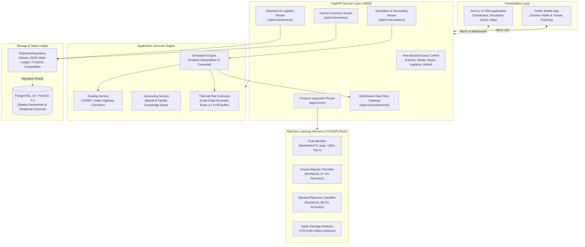

# AgriChain AI — System Architecture & Data Flow

## 1. System Overview

**AgriChain AI** is an intelligent agricultural exchange and cold-chain integrity platform. It bridges harvest-level quality inspection with real-time transit logistics, cold-storage facility matching, and perishable goods market operations across northern Indian agricultural corridors (Punjab, Haryana, Rajasthan, and Uttar Pradesh).

---

## 2. Core Architectural Components

### 2.1 Presentation Layer (`apps/web` & `apps/mobile`)
- **Next.js 14 Web Portal**: App Router (`/app/dashboard`, `/app/layout`), Tailwind CSS, Leaflet (`TrackingMapClient`), dynamic simulation HUD, and real-time WebSocket state management.
- **Flutter Mobile App** (`apps/mobile`): Android/iOS client scaffold for field produce photography, farmer lot creation, and GPS transponder tracking.

### 2.2 Backend Service Gateway (`backend/app`)
- **FastAPI Framework**: Modular RESTful routing with asynchronous WebSocket event broadcaster.
- **Role-Based Access Control**: Strict multi-role interface segregation across 5 primary stakeholders:
  - **Farmer**: Harvest lot inspection, warehouse intake suitability, stock management.
  - **Dealer**: Mandi intake lots, storage suitability verification, wholesale auctions.
  - **Buyer**: B2B produce marketplace, freshness verification, order lifecycle.
  - **Logistics**: Corridor route planning, GPS telemetry, live reefer tracking.
  - **Admin**: System telemetry, model registry, CUDA status, audit ledger.

### 2.3 Deep Learning Produce Inspection (`ml/`)
- **Zero-Guesswork Fruit Identification**: Automatic fruit categorization using MobileNetV3-Large before routing to crop-specific models.
- **Guava ResNet18**: 3-class maturity taxonomy (`Green`, `Mature Green`, `Ripe`).
- **Banana ResNet18**: 4-class ripeness taxonomy (`Underripe`, `Barely Ripe`, `Ripe`, `Overripe`).
- **Apple YOLOv8n**: Bounding-box detection for surface defects and scab lesions.

### 2.4 Geospatial & Simulation Engine
- **OSRM Driving Engine**: Real-road highway driving distance and vertex geometry calculation across northern Indian transit routes (NH-7, NH-9, NH-44, NH-52).
- **Polyline Interpolation**: Strict mathematical vehicle progression along highway polylines. Clamped strictly between route start `coords[0]` and destination `coords[-1]`.
- **Session Isolation**: Every simulation session is strictly isolated by `shipment_id`.
- **Reefer Thermal Window**: Cold-chain monitoring enforcing crop-specific temperature ranges (Guava: 4°C – 8°C; Banana: 13°C – 15°C).

### 2.5 Persistence Strategy
- **Authoritative JSON State Ledger** (`backend/app/db/.persisted_session.json`): Provides high-speed, zero-dependency local development persistence that survives backend restarts.
- **PostgreSQL / PostGIS Relational Database**: Migration scripts (`database/migrations/001_initial_postgis_schema.sql` through `005_simulation_sessions_and_telemetry.sql`) ready for full PostGIS deployment.

