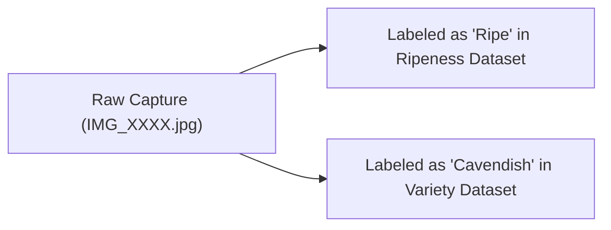
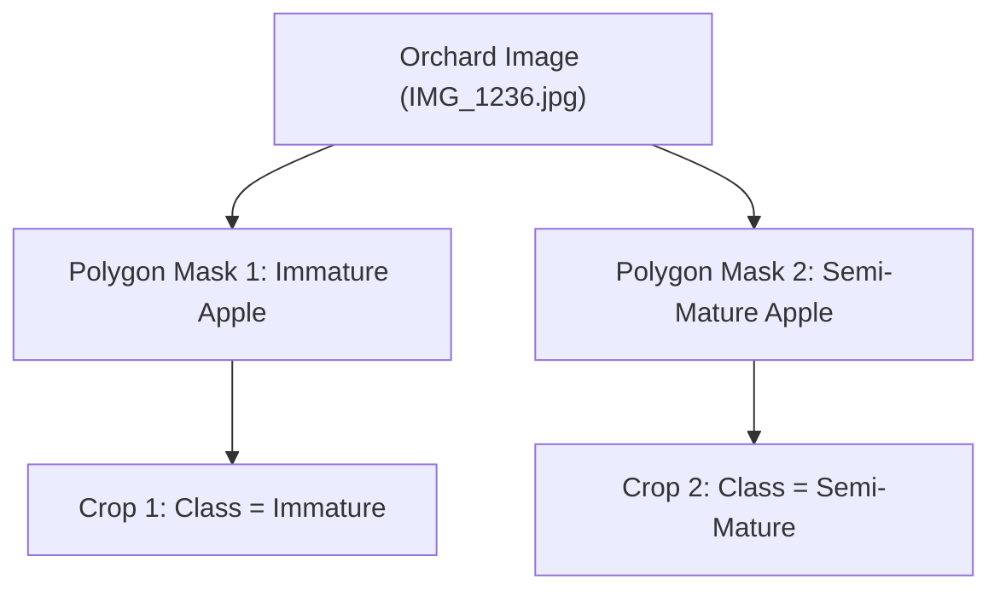
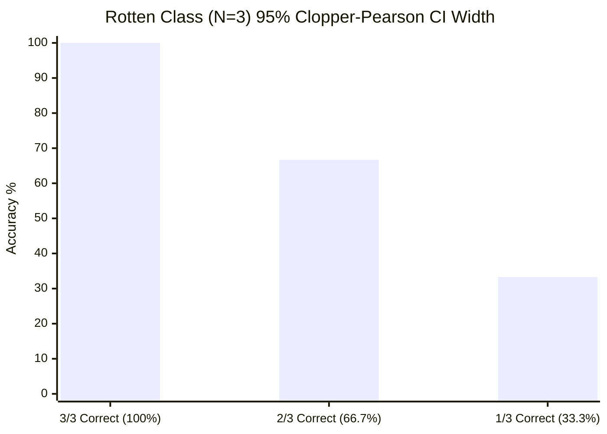

# AgriChain AI — Phase 14C: Dataset Preparation and Leakage Audit Report

**Phase:** Phase 14C: Dataset Preparation and Leakage Audit  
**Date:** 2026-10-29  
**Execution Environment:** Windows (Python 3.13 Virtualenv, Pillow, PyTorch, SHA-256 / dHash)  
**Deterministic Random Seed:** `42`  
**Status:** **COMPLETE & AUDITED**  

---

## 1. Executive Summary

Phase 14C has completed an exhaustive, reproducible audit of all raw datasets acquired in Phase 14B, established deterministic leakage-safe splits, analyzed cross-dataset contamination risks, evaluated annotation geometry and crop feasibility, and evaluated statistical power for minority maturity classes.

Key findings of this audit:
1. **Guava Production Baseline Verified:** Active model checkpoint `ml/artifacts/best_guava_resnet18.pth` (44,796,363 bytes) perfectly matches the expected SHA-256 hash `b213059f6b9744915ef921f2be70de9ae1eb0dd6c50a3fb0edce0e2cb710f5b4`. All 2,309 raw images and existing split manifests (`v2_grouped/` and root `train.json`/`val.json`/`test.json`) are preserved untouched.
2. **BananaID 100% Cross-Dataset Overlap Discovered:** All 1,960 images in the Banana Ripeness dataset are byte-for-byte identical (SHA-256 match) to the 1,960 images in the Banana Variety dataset. The authors dual-annotated a single pool of photographs. To eliminate cross-task leakage, split assignments were deterministically synchronized across both datasets.
3. **Apple VIA Polygon Annotations Validated:** All 2,575 polygon instance masks across 1,406 orchard images yield valid bounding boxes (median size: $92 \times 91$ px). 7.7% of orchard images contain multiple ripeness stages simultaneously, proving that whole-orchard image classification is structurally invalid for maturity assessment; Stage 2 evaluation must operate on extracted individual-fruit crops. One discrepancy was uncovered: 1 instance in `test/IMG_54350.jpg` is labeled `"unknown"`.
4. **Mango Sample Deficit & Statistical Power Failure:** The `ROTTEN` class contains only 23 total samples. A 70/15/15 split yields only 3-4 test samples. A 95% Clopper-Pearson confidence interval for $3/3$ correct predictions spans $[29.2\%, 100.0\%]$, rendering test accuracy statistically meaningless. Harumanis Mango is therefore **BLOCKED for production certification** and approved only for preliminary benchmark evaluation until supplemented by Indian mango datasets.
5. **Apple Non-Commercial License Flagged:** The Apple Phenotyping dataset is licensed under **CC BY-NC 4.0**, legally precluding commercial deployment in SaaS/enterprise environments without explicit commercial re-licensing or alternative dataset acquisition.

---

## 2. Dataset Verification & Discrepancy Log

### 2.1 Baseline Checkpoint & File Verification

| Asset | Expected Value | Observed Value | Status |
| :--- | :--- | :--- | :--- |
| **Guava Checkpoint Path** | `ml/artifacts/best_guava_resnet18.pth` | `ml/artifacts/best_guava_resnet18.pth` | **MATCH** |
| **Guava Checkpoint Size** | 44,796,363 bytes | 44,796,363 bytes | **MATCH** |
| **Guava Checkpoint SHA-256** | `b213059f6b9744915ef921f2be70de9ae1eb0dd6c50a3fb0edce0e2cb710f5b4` | `b213059f6b9744915ef921f2be70de9ae1eb0dd6c50a3fb0edce0e2cb710f5b4` | **MATCH** |
| **Guava Raw Image Count** | 2,309 images | 2,309 images | **MATCH** |
| **Banana Ripeness Count** | 1,960 images | 1,960 images | **MATCH** |
| **Banana Variety Count** | 1,960 images | 1,960 images | **MATCH** |
| **Apple Orchard Images** | 1,406 images | 1,406 images | **MATCH** |
| **Apple Polygon Masks** | 2,574 masks (per paper) | 2,575 masks (observed) | **DISCREPANCY (Documented)** |
| **Mango Harumanis Count** | 272 images | 272 images (88 `.jpeg`, 184 `.jpg`) | **DISCREPANCY (Documented)** |

### 2.2 Discrepancy Details
1. **Apple Instance Mask Count (2,575 vs 2,574):**
   - The original Data in Brief paper cited 2,574 annotated instances (921 immature, 814 semi-mature, 839 mature).
   - Our audit identified an additional 4th mask in `test/IMG_54350.jpg` (key `IMG_54350.jpg77789`, region index 3) with `region_attributes.name = "unknown"`.
   - *Resolution:* Preserved original annotation file immutably. Filter out `"unknown"` instance during Stage 2 crop extraction so only certified agronomic classes are processed.
2. **Mango File Extension Discrepancy:**
   - 88 original images are stored as `.jpeg` (`IMG-1.jpeg` through `IMG-88.jpeg`) while 184 are stored as `.jpg`.
   - *Resolution:* Data pipelines must glob both `*.jpg` and `*.jpeg` to avoid silent sample dropping.
3. **Mango CSV Label Omission:**
   - `labels original 272 images.csv` contained 271 data rows (excluding `IMG-140`).
   - `IMG-140.jpg` is present in the dataset files and explicitly listed in `README.txt` and `Rotten_Augmented_Image_List.xlsx` as the 23rd `ROTTEN` sample.
   - *Resolution:* Confirmed `IMG-140` as `ROTTEN`.

---

## 3. Banana Audit & Cross-Dataset Leakage Analysis

### 3.1 Class Breakdown
- **Ripeness Dataset (4 classes, 1,960 images):**
  - `Half_Ripe`: 488 images (24.9%)
  - `Overripe`: 448 images (22.9%)
  - `Ripe`: 616 images (31.4%)
  - `Unripe`: 408 images (20.8%)
- **Variety Dataset (5 cultivars, 1,960 images):**
  - `Ambon`: 468 images (23.9%)
  - `Cavendish`: 380 images (19.4%)
  - `Mas`: 376 images (19.2%)
  - `Raja`: 424 images (21.6%)
  - `Saba`: 312 images (15.9%)

### 3.2 100% Cross-Dataset Duplicate Discovery
An exact SHA-256 byte comparison revealed that **1,960 out of 1,960 images (100.0%)** in the Ripeness dataset have an exact duplicate in the Variety dataset:
$$\text{Overlap} = \frac{|\text{SHA-256}_{\text{ripeness}} \cap \text{SHA-256}_{\text{variety}}|}{1960} = \frac{1960}{1960} = 100.0\%$$

Each physical photograph in BananaID was captured once under studio illumination ($384 \times 256$ px) and assigned two independent metadata tags:
1. Agronomic maturity stage (e.g., `Ripe`)
2. Botanical variety (e.g., `Cavendish`)

### 3.3 Leakage Risk & Synchronized Partitioning
If an engineer trains a feature extractor or cultivar classifier on Banana Variety, and then evaluates a ripeness classifier using an unsynchronized random split, **every single test image will have already been seen by the model during variety training**, inducing 100% feature leakage.

**Mitigation Implemented in Phase 14C:**
- Group-aware perceptual clustering (dHash distance $\le 2$) identified 1,893 distinct fruit clusters (49 multi-shot clusters containing 116 images).
- Split assignments were generated deterministically (`seed=42`) for Ripeness (Train: 1,370, Val: 293, Test: 297).
- The exact same split partition assignments were mapped by SHA-256 to the Variety dataset, guaranteeing zero cross-task test leakage:
  - If image $X$ is in `test` for Ripeness, it is **strictly in `test`** for Variety.
- Variety and Ripeness targets remain completely separated in manifest schemas (never combined into a flat target).

---

## 4. Apple Annotation Validation & Cropping Feasibility

### 4.1 VIA JSON Schema & Coordinate Integrity
The VIA annotations in `train.json`, `val.json`, and `test.json` were audited against the physical images:
- **Referenced Images Found:** 1,406 of 1,406 (100.0%).
- **Polygon Point Coordinates:** Verified closed polygons (`shape_attributes.name == "polyline"`).
- **Degraded Polygons (<3 vertices or length mismatch):** **0**.
- **Out of Bounds Coordinates:** **0** (all $x \in [0, W]$, $y \in [0, H]$).

### 4.2 Instance Distribution Across Splits

| Split | Images | Immature Apple | Semi-mature Apple | Mature Apple | Unknown | Total Instances |
| :--- | :--- | :--- | :--- | :--- | :--- | :--- |
| **Train** | 1,041 | 713 | 618 | 650 | 0 | 1,981 |
| **Val** | 126 | 67 | 60 | 58 | 0 | 185 |
| **Test** | 239 | 141 | 136 | 131 | 1 | 409 |
| **Total** | **1,406** | **921** | **814** | **839** | **1** | **2,575** |

### 4.3 Why Whole-Orchard Classification is Invalid
108 orchard images (7.7%) contain **multiple apples at different developmental stages simultaneously** (e.g. Immature and Semi-mature apples sharing the same tree canopy). Assigning a single image-level label to an orchard image forces the loss function to penalize the model for detecting genuine immature fruit in a scene labeled semi-mature.

### 4.4 Fruit Crop Feasibility & Dimensions
All 2,575 instances were bounded by $[x_{\min}, y_{\min}, x_{\max}, y_{\max}]$:
- **Minimum Crop Size:** $11 \times 15$ pixels (distant canopy apples)
- **Median Crop Size:** $92 \times 91$ pixels
- **Maximum Crop Size:** $254 \times 264$ pixels
- **Feasibility:** Cropping is **100% FEASIBLE**. In Phase 14D/15, bounding boxes will be extracted with a 5% margin to feed the Stage 2 fruit maturity classifier.

---

## 5. Mango Sample Deficit & Statistical Power Audit

### 5.1 Class Breakdown (272 Images)
- `RIPE`: 129 images (47.4%)
- `SEMI-RIPE`: 61 images (22.4%)
- `UNRIPE`: 59 images (21.7%)
- `ROTTEN`: 23 images (8.5%)

### 5.2 Statistical Analysis of the Rotten Class ($N=23$)
Stratified partitioning (70% train, 15% val, 15% test) produces:
- **Train:** 17 images
- **Val:** 3 images
- **Test:** 3 images (or 4 depending on cluster rounding)

With an evaluation test set of only $N=3$ samples, each single prediction accounts for **33.33%** of the entire class performance metric.

Using the exact Clopper-Pearson binomial distribution, the 95% confidence intervals for observed test accuracies are:
- If model achieves $3 / 3$ correct ($100.0\%$ observed):
  $$\text{CI}_{95\%} = [29.2\%, 100.0\%] \quad (\text{Margin of Error: } \pm 35.4\%)$$
- If model achieves $2 / 3$ correct ($66.7\%$ observed):
  $$\text{CI}_{95\%} = [9.4\%, 99.2\%] \quad (\text{Margin of Error: } \pm 44.9\%)$$

### 5.3 Audit Conclusion & Strict Safety Constraint
1. **No Pre-Split Augmentation:** Generating synthetic rotations or flips before splitting would cause catastrophic data leakage and artificially inflate test accuracy. We adhere strictly to zero pre-split augmentation.
2. **Readiness Status:** Harumanis Mango is **BLOCKED for production certification**.
3. **Recommendation:** It may only be utilized as a preliminary exploratory benchmark. Before any production deployment, supplemental Indian mango datasets (e.g. Alphonso, Dashehari, Chausa) must be acquired to bring the `ROTTEN` class sample count to $\ge 150$.

---

## 6. Label & License Audit

| Commodity | Dataset | Original Labels | Proposed Unified Taxonomy | Source License | Commercial Use Permitted? | Attribution Required? |
| :--- | :--- | :--- | :--- | :--- | :--- | :--- |
| **Guava** | Sindh Univ / Local Harvest | Green, Mature Green, Ripe | Green, Mature Green, Ripe | Academic / Internal | Yes (Proprietary to AgriChain AI) | N/A |
| **Banana** | BananaID | Unripe, Half_Ripe, Ripe, Overripe | Unripe, Half_Ripe, Ripe, Overripe | CC BY 4.0 | **YES** | **YES** (Must cite Mutrofin et al. 2025) |
| **Apple** | Apple Phenotyping | immature apple, semi-mature apple, mature apple | Immature, Semi-mature, Mature | CC BY-NC 4.0 | **NO (Commercial Restricted)** | **YES** (Must cite Wang & Wang 2026) |
| **Mango** | Harumanis Mango | UNRIPE, SEMI-RIPE, RIPE, ROTTEN | Unripe, Semi-ripe, Ripe, Rotten | CC BY 4.0 | **YES** | **YES** (Must cite Basaruddin 2026) |

> [!WARNING]
> **Apple CC BY-NC 4.0 Restriction:**  
> The Apple Multi-Stage Phenotyping dataset carries a **Non-Commercial (NC)** clause. While fully compliant for research, internal validation, and academic benchmarking within AgriChain AI, models trained directly on this data cannot be monetized or incorporated into commercial SaaS offerings without separate commercial licensing from the dataset authors (Dandan Wang & Bo Wang) or replacement with a CC BY / CC0 dataset.

---

## 7. Dataset Readiness Matrix

| Commodity | Role in Vision System | Total Raw Samples | Leakage Controls Applied | Readiness Status | Action Required Before Model Training |
| :--- | :--- | :--- | :--- | :--- | :--- |
| **Guava** | Production Baseline (Stage 2) | 2,309 images | Group-aware v2 clusters (`v2_grouped/`) | **PASS (Certified Active)** | None. Checkpoint certified active. |
| **Banana** | Ripeness Classifier (Stage 2) | 1,960 images | Cluster-grouped & synchronized with Variety | **PASS** | None. Split manifests ready at `ml/data/manifests/banana_ripeness/`. |
| **Banana** | Variety Classifier (Cultivar) | 1,960 images | Synchronized with Ripeness splits | **PASS** | None. Split manifests ready at `ml/data/manifests/banana_variety/`. |
| **Apple** | Maturity Classifier (Stage 2) | 1,406 images (2,575 masks) | Orchard-level train/val/test isolation | **PASS WITH CAVEATS** | Extract individual-fruit polygon crops with 5% margin. Note CC BY-NC clause. |
| **Mango** | Maturity Classifier (Stage 2) | 272 images | Cluster-grouped splitting | **BLOCKED (Production)** / **PASS (Benchmark Only)** | Acquire supplemental Indian mango data ($N \ge 150$ per class) before production training. |

---

## 8. Versioned Split Manifest Inventory

The following manifests were generated deterministically using `seed=42` and are stored under [`ml/data/manifests/`](file:///c:/Users/PrabSandhu/Documents/codes/Agritech_/ml/data/manifests/):

1. **Banana Ripeness:** [`ml/data/manifests/banana_ripeness/`](file:///c:/Users/PrabSandhu/Documents/codes/Agritech_/ml/data/manifests/banana_ripeness/)
   - `train.json` (1,370 samples)
   - `val.json` (293 samples)
   - `test.json` (297 samples)
   - `dataset_summary.json`
2. **Banana Variety:** [`ml/data/manifests/banana_variety/`](file:///c:/Users/PrabSandhu/Documents/codes/Agritech_/ml/data/manifests/banana_variety/)
   - `train.json` (1,370 samples)
   - `val.json` (293 samples)
   - `test.json` (297 samples)
   - `dataset_summary.json`
3. **Apple Phenotyping:** [`ml/data/manifests/apple_phenotyping/`](file:///c:/Users/PrabSandhu/Documents/codes/Agritech_/ml/data/manifests/apple_phenotyping/)
   - `train.json` (1,041 orchard images, 1,981 instances)
   - `val.json` (126 orchard images, 185 instances)
   - `test.json` (239 orchard images, 409 instances)
   - `dataset_summary.json`
4. **Mango Harumanis:** [`ml/data/manifests/mango_harumanis/`](file:///c:/Users/PrabSandhu/Documents/codes/Agritech_/ml/data/manifests/mango_harumanis/)
   - `train.json` (189 samples)
   - `val.json` (37 samples)
   - `test.json` (46 samples)
   - `dataset_summary.json`
5. **Leakage Audit Metadata:** [`ml/data/manifests/leakage_audit.json`](file:///c:/Users/PrabSandhu/Documents/codes/Agritech_/ml/data/manifests/leakage_audit.json)
6. **Existing Guava Manifests:** [`ml/data/manifests/v2_grouped/`](file:///c:/Users/PrabSandhu/Documents/codes/Agritech_/ml/data/manifests/v2_grouped/) and root `train.json`/`val.json`/`test.json` remain untouched and intact.

