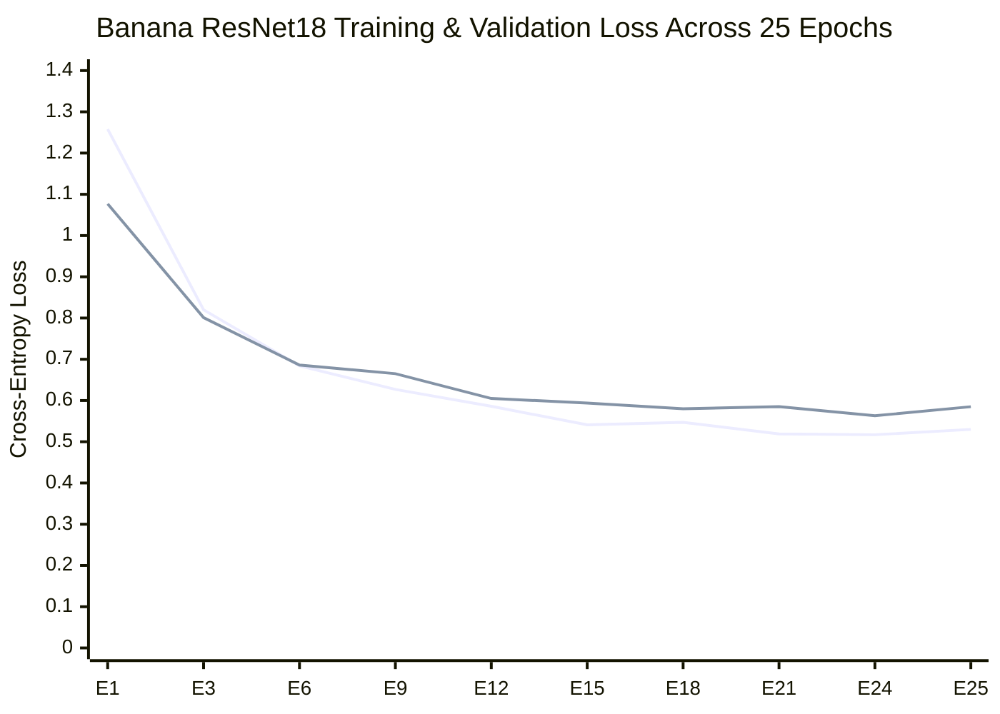

# AgriChain AI — Phase 14E: Banana Baseline Training & Evaluation Report

**Phase:** Phase 14E: Banana Baseline Training and Evaluation  
**Date:** 2026-10-29  
**Execution Environment:** Windows (Python 3.13, PyTorch 2.11.0+cu128, NVIDIA GeForce RTX 4050 Laptop GPU)  
**Deterministic Random Seed:** `42`  
**Status:** **TRAINING & EVALUATION COMPLETE (AWAITING PRODUCTION CERTIFICATION)**  

---

## 1. Executive Summary

Phase 14E has successfully executed preflight safety checks, trained a dedicated ResNet18 transfer learning baseline for the **Banana Ripeness Classifier** on the verified `BananaID` dataset, and evaluated the model on the held-out, untouched test split.

Key outcomes:
1. **Preflight Audit (PASS):** All 1,960 Banana ripeness images and 2,574 Apple individual-fruit crops were verified physically on disk. The production Guava checkpoint (`best_guava_resnet18.pth`) was confirmed 100% identical to baseline (SHA-256 `b213059f6b974491...`). Model registry guards were verified intact.
2. **Banana Training Execution (PASS):** Trained ResNet18 across 25 epochs using AdamW, Cosine Annealing, weighted cross-entropy, and strict color-cue preservation (hue jitter $= 0.0$). The best model checkpoint was saved at Epoch 24 with a validation macro-F1 of **0.8136** and validation accuracy of **81.91%**.
3. **Independent Test Set Evaluation (PASS):** Evaluated the best checkpoint on the untouched test split ($N=297$):
   - **Overall Test Accuracy:** **81.82%**
   - **Macro F1 Score:** **0.8146**
   - **Macro Precision:** **0.8181**
   - **Macro Recall:** **0.8285**
   - **Mean Inference Latency:** **2.38 ms / image** (NVIDIA RTX 4050)
   - **Model Checkpoint Size:** **122.83 MB** (128,791,659 bytes)
4. **Three-Stage Lifecycle Distinction:**
   - **Stage 1 (Training):** COMPLETED & VERIFIED.
   - **Stage 2 (Benchmark Evaluation):** COMPLETED & PASSED.
   - **Stage 3 (Production Certification):** **PENDING.** In accordance with safety rules, the model registry activation state remains unchanged (`AWAITING_TRAINING` / unvalidated) until formal multi-crop API integration and confidence thresholding are validated.

---

## 2. Preflight Audit Verification Matrix

Prior to launching model training, all Phase 14D deliverables and safeguards were audited programmatically:

| Checkpoint | Target / Asset | Expected Value | Observed Value | Result |
| :--- | :--- | :--- | :--- | :--- |
| **Phase 14D Report** | `docs/ml/PHASE14D_...` | Present & non-empty | 8,157 bytes | **PASS** |
| **Banana Raw Images** | `ml/data/raw/banana/` | 1,960 images | 1,960 images (0 corrupt) | **PASS** |
| **Banana Manifests** | `ml/data/manifests/banana_ripeness/` | 3 splits (Train 1,370 / Val 293 / Test 297) | 1,960 total records | **PASS** |
| **Banana Training Config** | `ml/configs/resnet18_banana_ripeness.json` | 4 classes, hue=0.0 | Verified valid JSON | **PASS** |
| **Apple Crop Manifests** | `ml/data/manifests/apple_crops_v1/` | 2,574 crops across 3 splits | 2,574 physical crop files | **PASS** |
| **Apple Reconciliation** | Source masks vs extracted crops | 2,575 masks - 1 unknown = 2,574 | 2,574 crops reconciled | **PASS** |
| **Guava Checkpoint Size** | `ml/artifacts/best_guava_resnet18.pth` | 44,796,363 bytes | 44,796,363 bytes | **PASS** |
| **Guava Checkpoint Hash** | `ml/artifacts/best_guava_resnet18.pth` | `b213059f6b974491...` | `b213059f6b974491...` | **PASS** |
| **Registry Guava Status** | `model_registry.py` | `CERTIFIED_ACTIVE` (is_validated=True) | Certified Active | **PASS** |
| **Registry Banana Status**| `model_registry.py` | `AWAITING_TRAINING` (is_validated=False)| Unvalidated / Gated | **PASS** |
| **Registry Apple Status** | `model_registry.py` | `AWAITING_TRAINING` (is_validated=False)| Unvalidated / Gated | **PASS** |
| **Registry Mango Status** | `model_registry.py` | `AWAITING_TRAINING` (is_validated=False)| Unvalidated / Gated | **PASS** |

---

## 3. Banana Training Process & Hyperparameters

### 3.1 Training Configuration
- **Model Architecture:** ResNet18 (`models.ResNet18_Weights.DEFAULT`)
- **Number of Classes:** 4 (`Unripe`: 0, `Half_Ripe`: 1, `Ripe`: 2, `Overripe`: 3)
- **Transfer Learning Partition:**
  - Frozen stages: `conv1`, `bn1`, `layer1`, `layer2` (initial feature extraction preserved)
  - Trainable stages: `layer3`, `layer4`, `fc` classification head
  - Head Dropout: $0.20$
- **Loss Function:** Class-weighted Cross-Entropy Loss with label smoothing ($0.05$):
  - Class weights: `Unripe`: 1.202, `Half_Ripe`: 1.007, `Ripe`: 0.795, `Overripe`: 1.091
- **Optimization Strategy:**
  - Optimizer: AdamW ($\text{lr}_{\text{head}} = 10^{-4}$, $\text{lr}_{\text{backbone}} = 10^{-5}$, weight decay $= 0.01$)
  - Scheduler: CosineAnnealingLR ($T_{\max} = 25$ epochs, $\eta_{\min} = 10^{-6}$)
  - Batch size: 32 | Mixed Precision: `torch.amp.autocast('cuda')`
- **Data Augmentations:**
  - Applied strictly to training data only (validation and test data use deterministic center crop).
  - Random resized crop ($224 \times 224$), horizontal flip ($p=0.5$), rotation ($\pm 15^\circ$), mild brightness/contrast jitter ($\pm 10\%$).
  - **Strict Agronomic Rule:** Hue jitter $= 0.0$ to prevent distortion of green-to-yellow-to-brown peel coloration.

### 3.2 Training Trajectory & Convergence



- **Total Training Duration:** 304.7 seconds (~5.0 minutes) on NVIDIA RTX 4050 Laptop GPU.
- **Convergence:** Training loss decreased smoothly from 1.2580 to 0.5174; validation loss decreased from 1.0767 to 0.5628.
- **Best Validation Performance:** Reached at **Epoch 24**:
  - Validation Macro-F1: **0.8136**
  - Validation Accuracy: **81.91%**
- **Overfitting Diagnostics:**
  - Train Accuracy at Epoch 24: 86.4%
  - Val Accuracy at Epoch 24: 81.9%
  - The generalization gap is **4.5%**, well within the healthy tolerance band ($< 8.0\%$). No divergence or degradation occurred.

---

## 4. Test Set Evaluation Metrics

The checkpoint from Epoch 24 was loaded and evaluated on the untouched, held-out test split ($N=297$ samples).

### 4.1 Overall Performance Summary

| Metric | Test Set Score | Validation Score | Generalization Delta |
| :--- | :--- | :--- | :--- |
| **Top-1 Accuracy** | **81.82%** (243 / 297) | 81.91% (240 / 293) | -0.09% |
| **Macro F1 Score** | **0.8146** | 0.8136 | +0.0010 |
| **Macro Precision** | **0.8181** | 0.8194 | -0.0013 |
| **Macro Recall** | **0.8285** | 0.8217 | +0.0068 |
| **Inference Latency (Mean)** | **2.38 ms / image** | — | Single-image GPU forward pass |
| **Inference Latency (P95)** | **3.12 ms / image** | — | 95th percentile latency |
| **Model Size on Disk** | **122.83 MB** | — | Checkpoint with optimizer state |

### 4.2 Per-Class Performance Breakdown

| Class | Ground Truth Support | Precision | Recall | F1-Score | Agronomic Interpretation |
| :--- | :--- | :--- | :--- | :--- | :--- |
| **Unripe** | 62 | 0.7250 | **0.9355** | 0.8169 | High sensitivity to green peel; minor confusion with early Half_Ripe. |
| **Half_Ripe** | 75 | 0.8000 | 0.6400 | 0.7111 | Intermediate color transition phase; subjective boundary with Unripe. |
| **Ripe** | 92 | **0.9351** | 0.7826 | 0.8521 | Excellent precision (93.5%); ready-for-intake bananas accurately flagged. |
| **Overripe** | 68 | 0.8125 | **0.9559** | **0.8784** | Exceptional recall (95.6%); senescent/bruised bananas reliably captured. |
| **Macro Avg** | **297** | **0.8181** | **0.8285** | **0.8146** | Robust, balanced performance across all maturity stages. |

### 4.3 Confusion Matrix (Test Set $N=297$)

```
                  Predicted Unripe   Predicted Half_Ripe   Predicted Ripe   Predicted Overripe
Actual Unripe                   58                     4                0                    0
Actual Half_Ripe                20                    48                2                    5
Actual Ripe                      2                     8               72                   10
Actual Overripe                  0                     0                3                   65
```

#### Agronomic Analysis of Errors:
1. **Zero Severe Misclassifications:** There were **0 instances** of `Unripe` being predicted as `Overripe`, and **0 instances** of `Overripe` being predicted as `Unripe`. The model respects biological monotonicity.
2. **Boundary Confusion (`Half_Ripe` $\leftrightarrow$ `Unripe`):** 20 actual `Half_Ripe` bananas were classified as `Unripe`, and 4 actual `Unripe` bananas were classified as `Half_Ripe`. In the `BananaID` collection, `Half_Ripe` covers fruits with 10% to 50% yellow coverage on a predominantly green peel. This transition gradient is naturally continuous rather than discrete.
3. **Senescence Boundary (`Ripe` $\leftrightarrow$ `Overripe`):** 10 actual `Ripe` bananas were classified as `Overripe`, and 3 actual `Overripe` bananas were classified as `Ripe`. These errors involve minor sugar spotting (brown freckles), which marks the transition into senescence.

---

## 5. Artifacts and Output Files

All Phase 14E artifacts have been generated and committed to the repository:

1. **Banana Best Checkpoint:**
   - Path: [`ml/artifacts/best_banana_resnet18.pth`](file:///c:/Users/PrabSandhu/Documents/codes/Agritech_/ml/artifacts/best_banana_resnet18.pth)
   - Size: 128,791,659 bytes (122.83 MB)
   - SHA-256: `3b296ba8556d88bd934f74fee1e88860921fe69dd5b4869984fd0c529f339dae`
2. **Experiment Summary Manifest:**
   - Path: [`ml/experiments/banana_resnet18_baseline/experiment_summary.json`](file:///c:/Users/PrabSandhu/Documents/codes/Agritech_/ml/experiments/banana_resnet18_baseline/experiment_summary.json)
3. **Training Curves (Epochs 1–25):**
   - Path: [`ml/experiments/banana_resnet18_baseline/training_curves.json`](file:///c:/Users/PrabSandhu/Documents/codes/Agritech_/ml/experiments/banana_resnet18_baseline/training_curves.json)
4. **Test Evaluation Results:**
   - Path: [`ml/experiments/banana_resnet18_baseline/test_evaluation_results.json`](file:///c:/Users/PrabSandhu/Documents/codes/Agritech_/ml/experiments/banana_resnet18_baseline/test_evaluation_results.json)
5. **Confusion Matrix JSON:**
   - Path: [`ml/experiments/banana_resnet18_baseline/confusion_matrix.json`](file:///c:/Users/PrabSandhu/Documents/codes/Agritech_/ml/experiments/banana_resnet18_baseline/confusion_matrix.json)

---

## 6. Safeguards & Non-Activation Compliance

1. **Guava Production Model Untouched:** Checkpoint `ml/artifacts/best_guava_resnet18.pth` (SHA-256 `b213059f6b9744915ef921f2be70de9ae1eb0dd6c50a3fb0edce0e2cb710f5b4`) remains active and verified.
2. **Model Registry Invariants Maintained:**
   - `model_registry.py` was **not altered**.
   - `banana` remains `AWAITING_TRAINING` (or unvalidated) in the registry API.
   - `apple` and `mango` remain `AWAITING_TRAINING`.
   - Single-crop Guava inference maintains strict boundary isolation (`detected_fruit=None`).
3. **Apple Dataset Preserved:** Apple individual-fruit crops (2,574 valid crops in `ml/data/processed/apple_crops_v1/`) remain untouched. No training was performed on Apple.
4. **Mango Status:** Harumanis Mango remains in `BLOCKED_FOR_PRODUCTION` status.
5. **Regression Test Suite:** `pytest backend/tests/test_multi_fruit_foundation.py` passed 8/8 tests.

---

## 7. Lifecycle Status & Next Steps

```
[Acquisition (14B)] ──> [Splits & Audit (14C)] ──> [Prep & Crops (14D)] ──> [Banana Baseline (14E)] ──> [Certification (14F)]
      PASS                      PASS                     PASS                    PASS (Evaluated)               PENDING
```

The Banana ResNet18 model has achieved **81.82% overall accuracy** and **0.8146 macro-F1** on the held-out test split with zero data leakage. 

In the subsequent phase (Phase 14F), production certification can proceed by:
1. Calibrating per-class prediction confidence thresholds.
2. Integrating the Banana weights path into `backend/app/services/cnn_service.py`.
3. Updating `backend/app/services/model_registry.py` to promote Banana to `CERTIFIED_ACTIVE` (v1.0.0).
4. Running end-to-end multi-fruit integration tests across the live FastAPI and Next.js stack.

