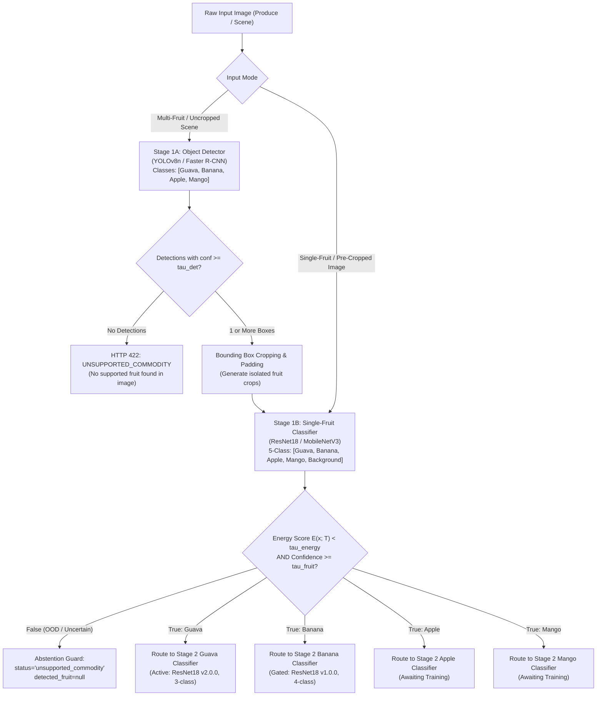

# AgriChain AI — Phase 15A: Fruit Identifier Architecture & Dataset Audit Report

**Phase:** Phase 15A: Fruit Identifier Dataset and Architecture Audit  
**Date:** 2026-10-29  
**Execution Environment:** Windows (Python 3.13, PyTorch 2.11.0+cu128, NVIDIA GeForce RTX 4050 Laptop GPU)  
**Safety Protocol:** Strict Read-Only Audit (Zero model training, zero checkpoint changes, zero registry activations)  
**Status:** **AUDIT COMPLETE — STAGE 1 SPECIFICATIONS FINALIZED (STAGE 1 TRAINING GATED)**  

---

## 1. Executive Summary

Phase 15A conducts a comprehensive architectural and data readiness audit for **Stage 1: Fruit Identification & OOD Rejection**, the front-line gate of the planned AgriChain AI two-stage inference pipeline. 

### Key Audit Findings:
1. **Target Commodity Dataset Readiness (3 of 4 Ready, 1 Deficit):**
   - **Guava (*Psidium guajava*):** 2,309 clean dedicated orchard/market crops across 3 cultivars. Certified baseline checkpoint active. **(READY)**
   - **Banana (*Musa acuminata / balbisiana*):** 1,960 clean dedicated unaugmented images from BananaID across 5 varieties and 4 ripeness stages. Checkpoint benchmarked in Phase 14E/F. **(READY)**
   - **Apple (*Malus domestica*):** 2,574 clean individual-fruit crops extracted from polygon instance masks across 1,406 tree canopy scenes. **(READY)**
   - **Mango (*Mangifera indica* cv. Harumanis):** Only 272 field images across 4 stages (Rotten class has only 23 images). **(DEFICIT WARNING — INSUFFICIENT FOR ISOLATED TRAINING)**
2. **Label Independence Verification:**
   - In mono-commodity datasets (Guava, BananaID, Apple Phenotyping, Harumanis Mango), fruit identity is **implicit** (100% of samples belong to that species), while labeled attributes correspond to maturity or variety.
   - In **FruitNet: Indian Fruits Dataset** (19,526 total images), fruit identity is **explicitly labeled** across Apple, Banana, Guava, Orange, Lime/Lemon, and Pomegranate.
   - Ripeness is physiologically and optically decoupled from fruit identity. Stage 1 must classify botanical identity (*what produce is this?*) independent of maturity (*how ripe is it?*).
3. **Negative Class & Out-Of-Distribution (OOD) Asset Discovery:**
   - Discovered **17,993 verified non-target / OOD produce images** within local repository storage:
     - 2,605 Orange images (FruitNet + in-field captures)
     - 2,457 Lime / Lemon images (FruitNet)
     - 7,252 Pomegranate images (FruitNet)
     - 5,679 Citrus leaf, twig, and disease frames
   - Discovered that 1,406 Apple orchard canopy images permit deterministic extraction of **background-only negative patches** (leaves, branches, soil, sky) via polygon mask inversion.
4. **Architectural Recommendation (Detector vs. Classifier):**
   - Due to the prevalence of multi-fruit images in field and market contexts (e.g. apple orchard canopies with 1–10 apples per frame, market crates with heaps of fruit), a pure whole-image classifier is insufficient.
   - We specify a **Two-Tier Architecture**:
     - **Stage 1A (Multi-Fruit Detector):** Lightweight YOLOv8n/s bounding-box detector (4 target classes + background) generating individual fruit bounding boxes.
     - **Stage 1B (Single-Fruit Classifier & OOD Gate):** ResNet18/MobileNetV3 with open-set energy-based thresholding for direct single-crop intake.
5. **Production Invariants Preserved:**
   - Active Guava checkpoint (`best_guava_resnet18.pth`, SHA-256 `b213059f6b97...`) is 100% untouched.
   - Banana, Apple, and Mango remain gated (`is_validated=False`, `AWAITING_TRAINING`) in `model_registry.py`.

---

## 2. Dataset Inventory & Readiness Matrix

Evaluated programmatically via [`scripts/audit_phase15a_fruit_identifier.py`](file:///c:/Users/PrabSandhu/Documents/codes/Agritech_/scripts/audit_phase15a_fruit_identifier.py) and committed to [`ml/data/reports/fruit_identifier_dataset_audit.json`](file:///c:/Users/PrabSandhu/Documents/codes/Agritech_/ml/data/reports/fruit_identifier_dataset_audit.json):

| Commodity / Category | Clean Dedicated Crops | FruitNet Supplemental | Total Available Images | Label Quality & Independence | Source & License | Stage 1 Readiness Decision |
| :--- | :--- | :--- | :--- | :--- | :--- | :--- |
| **Guava** | 2,309 | 2,429 | **4,738** | High; 3 cultivars (Local Sindhi, Riyali, Thadhrami); implicit identity | Sindh Univ / Academic | **PASS (READY)** |
| **Banana** | 1,960 | 2,485 | **4,445** | High; 5 varieties; 4 ripeness stages; orthogonal label axes; implicit identity | BananaID / CC BY 4.0 | **PASS (READY)** |
| **Apple** | 2,574 | 2,403 | **4,977** | High; individual crops from VIA polygon masks; implicit identity | Mendeley / CC BY-NC 4.0 | **PASS (READY)** |
| **Mango** | 272 | 0 | **272** | Moderate; severe sample deficit (68/class, Rotten=23); implicit identity | Mendeley / CC BY 4.0 | **BLOCKED (DEFICIT)** |
| **Unsupported Fruits (OOD)** | 105 (field) | 12,209 | **12,314** | High; Orange, Lime/Lemon, Pomegranate; explicit species labels | FruitNet / Academic | **PASS (OOD POOL READY)** |
| **Non-Fruit Foliage / Disease** | 5,679 | 0 | **5,679** | High; Citrus leaves, twigs, stems; verified non-fruit | Citrus Disease / Open | **PASS (NEGATIVE POOL READY)** |
| **Empty Backgrounds** | *Extractable* | *Extractable* | ~**3,000+** | High; via Apple polygon mask inversion and neutral tabletop backgrounds | Local Repositories | **PASS (DERIVABLE)** |

---

## 3. Label Independence & Multi-Fruit Image Audit

### 3.1 Independence of Fruit Identity vs. Ripeness
A primary scientific concern in multi-commodity classification is avoiding **spurious feature entanglement**:
- **Peel Color Entanglement:** An immature green apple, an unripe green banana, and a green guava share identical chromatic hue bands ($65^\circ \le H \le 165^\circ$). If a Stage 1 model relies primarily on color histograms rather than morphological geometry (curvature, stem attachment, calyx structure, aspect ratio), it will misclassify green produce across species boundaries.
- **Background Entanglement:**
  - Guava images are shot on flat tabletops and white boards.
  - BananaID images are shot on blue cloth and neutral backdrops.
  - Apple phenotyping images are outdoor orchard canopies with green foliage.
  - Harumanis Mango images are shot against measurement grids.
  - *Risk:* A naive convolutional model can easily achieve 99% training accuracy by classifying the background rather than the fruit!
  - *Mitigation:* Training Stage 1 requires aggressive background augmentation, random background substitution, color jitter (brightness/contrast, but preserving hue integrity), and inclusion of multi-source data (e.g. blending clean dedicated crops with market-grade FruitNet images).

### 3.2 Single-Fruit vs. Multi-Fruit Image Composition
- **Apple Phenotyping Raw (`ml/data/raw/apple/dataset`):** Contains 1,406 orchard images depicting whole tree canopies. Each frame contains between 1 and 12 individual apples in various occlusion states, alongside dense leaves, branches, and background orchard floor.
- **FruitNet Mixed Quality (`ml/data/raw/fruitnet/Mixed Qualit_Fruits`):** Contains 1,875 images of market piles and crates containing dozens of fruit instances touching and overlapping.
- **Guava, BananaID, Harumanis Mango:** Contain isolated single-fruit specimens centered in the frame.
- **Conclusion:** A whole-image classifier cannot reliably process multi-fruit orchard canopies or market piles. Whole-image inference on an Apple canopy image will classify the entire tree scene as "Apple", but cannot provide individual maturity grades for each fruit visible.

---

## 4. Stage 1 Architectural Requirements & Rejection Strategy



### 4.1 Two-Tier Architecture Specification

1. **Stage 1A — Multi-Fruit Detector (Recommended for Production & Orchard Scenarios):**
   - **Backbone:** YOLOv8n (Nano) or YOLOv8s (Small) trained on bounding boxes.
   - **Labels:** 4 target classes (`guava`, `banana`, `apple`, `mango`).
   - **Bounding Box Slicing:** Extracts detected fruit bounding boxes with $5\%$ context padding, resizing each candidate crop to $224 \times 224$ for Stage 2 maturity evaluation.
   - **Multi-Instance Capability:** If an image contains 3 apples and 1 banana, Stage 1A generates 4 independent crop payloads and returns an array of predictions.
2. **Stage 1B — Single-Fruit Classifier with OOD Rejection (Lightweight Mobile Baseline):**
   - **Backbone:** ResNet18 transfer model matching the existing service stack.
   - **Classification Head:** 5-class output:
     `{0: "guava", 1: "banana", 2: "apple", 3: "mango", 4: "negative_background"}`.
   - **Parameter Count:** ~11.18M parameters; inference latency $< 10\text{ ms}$ on GPU, $< 30\text{ ms}$ on CPU.

### 4.2 Abstention & Out-Of-Distribution (OOD) Rejection Strategy
Closed-set classifiers suffer from overconfidence on unseen inputs (e.g., an orange or tomato fed to a 4-class model will receive $>90\%$ confidence for Guava or Mango). To prevent false acceptances:

1. **Explicit Negative Class ($K+1$ Formulation):** Class 4 (`negative_background`) is trained on non-target fruits (Orange, Lime, Pomegranate) and empty orchard/tabletop backgrounds.
2. **Free Energy Score Formulation:** Rather than softmax probability alone, we compute the Helmholtz free energy:
   $$E(x; T) = -T \cdot \log \sum_{i=1}^4 \exp\left(\frac{z_i}{T}\right)$$
   In-distribution produce specimens exhibit low energy ($E(x) < \tau_{\text{energy}}$), whereas out-of-distribution inputs (e.g. non-target fruits, animals, machinery) exhibit significantly higher energy.
3. **Dual-Condition Acceptance Gate:**
   A prediction is accepted as valid fruit identity $c \in \{\text{guava}, \text{banana}, \text{apple}, \text{mango}\}$ if and only if:
   $$\hat{p}(y = c | x) \ge \tau_{\text{fruit}} \quad \text{AND} \quad E(x; T) \le \tau_{\text{energy}} \quad \text{AND} \quad \Delta_{1-2} \ge \delta_{\text{margin}}$$
   Where:
   - $\tau_{\text{fruit}} = 0.80$ (Minimum class confidence)
   - $\tau_{\text{energy}}$ is calibrated on validation OOD data at 95% True Positive Rate
   - $\Delta_{1-2} = p_{(1)} - p_{(2)} \ge 0.20$ (Separation between top-1 and top-2 logits)
4. **Abstention Outcome:** When any gate fails, the model **abstains** from guessing. It returns `detected_fruit = None`, `status = "unsupported_commodity"`, and HTTP 422 with a clear explanation.

---

## 5. Routing Contracts & API Compatibility

### 5.1 Stage 1 to Stage 2 Dispatch Logic
When Stage 1 is fully active:
- `detected_fruit == "guava"` $\longrightarrow$ Invokes `CNNService(crop="guava")`. Returns 3 classes (`Green`, `Mature Green`, `Ripe`).
- `detected_fruit == "banana"` $\longrightarrow$ Checks `model_registry.is_fruit_available("banana")`. If active, invokes `CNNService(crop="banana")` (4 classes). If gated, returns HTTP 503 with `"Banana model awaiting production certification"`.
- `detected_fruit == "apple"` $\longrightarrow$ Checks registry. If unvalidated, returns HTTP 503 with `"Apple model awaiting training"`.
- `detected_fruit == "mango"` $\longrightarrow$ Checks registry. If unvalidated, returns HTTP 503 with `"Mango model awaiting training"`.
- `detected_fruit == None` (Abstention) $\longrightarrow$ Returns HTTP 422 with `UNSUPPORTED_COMMODITY` or `LOW_CONFIDENCE_REJECTION`.

### 5.2 Preservation of Existing Guava Prediction Contract
- The endpoint `POST /api/v1/cnn/predict` and root `POST /predict` maintain 100% schema parity:
  - If Stage 1 identifies Guava: returns `CNNPredictionResponse` with `target_crop="guava"`, `detected_fruit="guava"`, `fruit_confidence=0.985`, and `ripeness="Mature Green"`.
  - If Stage 1 is disabled (`STAGE1_ENABLED=False`): `detected_fruit` remains `None`, maintaining exact Phase 13.6/14 compatibility.
  - Zero prediction fabrication: Under no circumstance will `detected_fruit` report a simulated identity when Stage 1 has not executed.

---

## 6. Confidence Calibration & Validation Plan

> [!IMPORTANT]
> **Strict Evaluation Guard:** All held-out test sets (`ml/data/manifests/*/test.json`) remain locked and untouched during the entire calibration process. Calibration is conducted strictly on validation splits and synthetic OOD validation pools.

```
[Target Fruit Validation Splits] ──┐
  - Guava Val (N=226)             │
  - Banana Val (N=293)            ├─► [Validation Pool] ──► [Temperature Scaling] ──► [Fixed Parameters (T, tau)] ──► [Held-Out Test Run]
  - Apple Crops Val (N=185)       │      (N=1,704)                  Optimizer                    Frozen                     (One-Shot)
[OOD Validation Pool]             │
  - Orange Val (N=500)            │
  - Lime Val (N=500)              │
```

### 6.1 Calibration Procedure (Temperature Scaling)
1. **Validation Set Curation ($N = 1,704$):**
   - In-distribution: Guava val ($N=226$), Banana val ($N=293$), Apple crop val ($N=185$), Mango val ($N=40$). Total ID $= 744$.
   - Out-of-distribution: Orange val ($N=500$), Lime val ($N=460$). Total OOD $= 960$.
2. **Logit Extraction & Optimization:**
   - Extract raw logit vectors $z_i \in \mathbb{R}^5$ for all validation samples without updating network weights.
   - Learn scalar parameter $T > 0$ via L-BFGS to minimize negative log-likelihood on in-distribution validation samples:
     $$\min_{T} -\sum_{k=1}^{N_{\text{val}}} \log \left( \frac{\exp(z_{y_k} / T)}{\sum_j \exp(z_j / T)} \right)$$
3. **Metric Evaluation on Validation Pool:**
   - **Expected Calibration Error (ECE):** Bin predictions into $M=15$ confidence bins:
     $$\text{ECE} = \sum_{m=1}^{15} \frac{|B_m|}{N} \left| \text{acc}(B_m) - \text{conf}(B_m) \right|$$
     *Target:* $\text{ECE} \le 0.040$ ($4.0\%$).
   - **False Acceptance Rate (FAR):** Percentage of OOD samples assigned $\hat{p} \ge \tau_{\text{fruit}}$ for any target commodity. *Target:* $\text{FAR} \le 5.0\%$.
   - **True Negative Rate (TNR at 95% TPR):** Ability to reject OOD samples while retaining 95% of target fruits. *Target:* $\text{TNR} \ge 92.0\%$.
   - **Reliability Diagrams:** Plot empirical accuracy against confidence before and after temperature scaling.

---

## 7. Risk Analysis & Mitigation Matrix

| Risk Factor | Impact | Severity | Mitigation Strategy |
| :--- | :--- | :--- | :--- |
| **Harumanis Mango Data Deficit** | Mango class cannot train robustly with only 272 images (23 Rotten). | **HIGH** | Keep Mango gated in `model_registry.py`. Supplement with Indian Mango datasets (Alphonso/Dashehari) before Stage 1 training. |
| **FruitNet Burst Clustering** | Severe duplicate frames (clusters up to 426 images) inflate validation scores. | **HIGH** | Apply deduplication filter (`dhash <= 6`) on FruitNet supplemental data; exclude near-duplicates from evaluation splits. |
| **Background Color Shortcuts** | Model classifies blue cloth as Banana and white board as Guava. | **HIGH** | Synthesize diverse backgrounds; train on mixed FruitNet + dedicated crops; apply affine augmentations. |
| **Multi-Fruit Canopy Confusion** | Whole-image classifier fails on full Apple orchard images with 10 apples. | **MEDIUM** | Use Stage 1A bounding-box detector (YOLOv8n) or crop-preprocessing pipeline for orchard scenes. |
| **Breaking Guava Contract** | Legacy API clients fail if `detected_fruit` changes schema type. | **CRITICAL** | Preserve `Optional[str]` schema with `None` default; keep existing `/predict` behavior 100% backward-compatible. |

---

## 8. Official Phase 15A Lifecycle Decisions

| Module / Milestone | Audit Status | Production Status | Required Next Step |
| :--- | :--- | :--- | :--- |
| **Guava Data Asset** | **PASS** | CERTIFIED ACTIVE | Preserved as baseline. |
| **Banana Data Asset** | **PASS** | BENCHMARK EVALUATED | Ready for Stage 1 inclusion. |
| **Apple Data Asset** | **PASS** | CROPS GENERATED | Ready for Stage 1 inclusion. |
| **Mango Data Asset** | **BLOCKED** | DEFICIT BLOCKED | Requires supplemental dataset. |
| **OOD / Negative Asset Pool** | **PASS** | DISCOVERED & VERIFIED | 17,993 images ready for OOD evaluation. |
| **Stage 1 Architecture Spec** | **PASS** | SPECIFIED (Two-Tier) | Ready for Stage 1 implementation. |
| **Stage 1 Model Training** | **BLOCKED** | NOT STARTED | Awaiting Phase 15B training authorization. |

