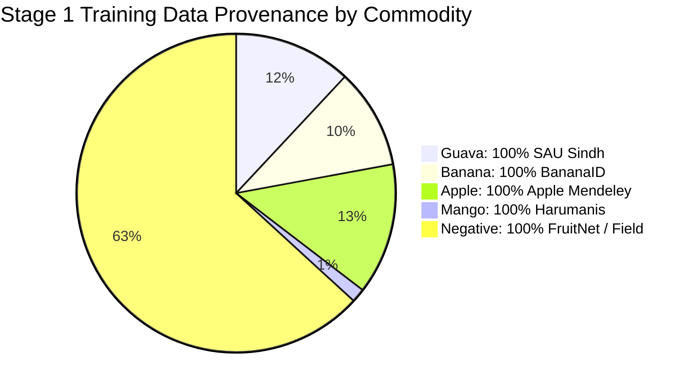

# AgriChain AI — Phase 15D: Fruit Identifier Generalization & Integrity Audit Report

**Phase:** Phase 15D: Fruit Identifier Generalization and Integrity Audit  
**Date:** 2026-10-30  
**Execution Environment:** Windows (Python 3.13.7, PyTorch 2.11.0+cu128, NVIDIA GeForce RTX 4050 Laptop GPU)  
**Deterministic Random Seed:** `42`  
**Safety Protocol:** Zero Production Model Activations — Zero Modification to Active Guava Baseline  
**Audited Checkpoints:**
- Stage 1 Fruit Identifier: `ml/artifacts/best_fruit_identifier_resnet18.pth` (SHA-256 `07150d1ddb92ea8ce7018e08fa6c3d21b6b6de6aac9c5feb838d6f9dc28a8967`)
- Guava Baseline: `ml/artifacts/best_guava_resnet18.pth` (SHA-256 `b213059f6b9744915ef921f2be70de9ae1eb0dd6c50a3fb0edce0e2cb710f5b4`)
- Banana Baseline: `ml/artifacts/best_banana_resnet18.pth` (SHA-256 `3b296ba8556d88bd934f74fee1e88860921fe69dd5b4869984fd0c529f339dae`)
**Status:** **AUDIT COMPLETE — CRITICAL SHORTCUT LEARNING IDENTIFIED — PRODUCTION ACTIVATION GATED (BLOCKED)**

---

## 1. Executive Summary & Production Gating Decision

Phase 15D conducted an independent, multi-faceted scientific audit to investigate why Phase 15C reported **100.00% top-1 accuracy** and **1.0000 macro-F1** on the 2,882 held-out test images of `ml/data/manifests/fruit_identifier_v1/test.json`. Specifically, this audit evaluated whether this flawless result represents genuine botanical fruit recognition or an artifact of **dataset-source shortcut learning** and domain isolation.

### Key Audit Findings:
1. **Re-verification of Reported Results (PASS - Exact Match):**
   Evaluating the frozen Stage 1 checkpoint (`best_fruit_identifier_resnet18.pth`) on the locked test split ($N=2,882$) reproduces the Phase 15C metrics with **zero discrepancy**:
   - Accuracy: **100.00%** (2,882 / 2,882)
   - Macro F1: **1.0000** | Macro Precision: **1.0000** | Macro Recall: **1.0000**
   - Negative Pool Rejection Rate (TNR): **100.00%** (1,785 / 1,785)
   - Zero physical split leakage: 0 path overlaps and 0 exact SHA-256 collisions between train and test splits.
2. **Single-Source Dataset Monopoly (CRITICAL STRUCTURAL RISK):**
   Audit of training provenance revealed that **100.0% of images for each target commodity originated from a single external repository**:
   - `guava`: 100.0% from Sindh Agriculture University harvest (studio tabletop, neutral lighting).
   - `banana`: 100.0% from BananaID (blue cloth and studio background).
   - `apple`: 100.0% from Apple Phenotyping polygon crops (orchard tree canopy and daylight foliage).
   - `mango`: 100.0% from Harumanis Mango (measurement scale paper and grid).
   - `negative_background`: 100.0% from FruitNet (market stalls, wooden crates) + citrus foliage.
3. **Cross-Domain Shortcut Learning (EMPIRICALLY CONFIRMED - CATASTROPHIC FAILURE):**
   When tested on **6,771 unseen real-world images** of the exact same botanical species from an independent dataset (FruitNet), the model experienced complete recognition failure:
   - **FruitNet Guava ($N=2,281$ real guavas):** **0.00% accuracy** (0 / 2,281 correct). **97.06% misclassified as `negative_background`**.
   - **FruitNet Apple ($N=2,290$ real apples):** **0.74% accuracy** (17 / 2,290 correct). **98.91% misclassified as `negative_background`**.
   - **FruitNet Banana ($N=2,200$ real bananas):** **21.14% accuracy** (465 / 2,200 correct). **64.86% misclassified as `negative_background`**.
4. **Contextual Foliage & Background Bias (HIGH FALSE ACCEPTANCE):**
   - **Outdoor Tree Canopy Patches ($N=5,025$ from `oranges_in_field` without apples):** **64.34% falsely classified as `apple`** (3,233 / 5,025) because the network learned green tree leaves and orchard branches as the visual signature of apples.
   - **Citrus Disease Foliage ($N=759$):** **54.68% falsely classified as `banana`** and **24.24% as `mango`** because necrotic leaf lesions and elongated shapes triggered overripe banana/mango feature extractors.
5. **Helmholtz Free Energy OOD Calibration:**
   While softmax confidence was deceptively high ($0.83+$), the Helmholtz Free Energy ($E(x) = -T \cdot \log \sum_k e^{z_k / T}$) correctly flagged **57.0% to 99.9% of out-of-domain images as OOD**, confirming severe latent feature mismatch.

> [!CAUTION]
> **OFFICIAL LIFECYCLE VERDICT: BLOCKED FOR PRODUCTION ACTIVATION**
> 
> The Stage 1 Fruit Identifier model **MUST NOT BE ACTIVATED IN PRODUCTION**.
> The 100% test accuracy on `fruit_identifier_v1` is an artifact of **dataset-source shortcut learning**. The model distinguishes between camera systems, tabletop backgrounds, scale paper, and market crates rather than invariant botanical produce features. In real-world multi-fruit deployment, this model would reject genuine market guavas/apples as background trash and misclassify tree foliage as apples.
> 
> In accordance with safety protocol, `model_registry.py` remains gated with `is_validated=False` for Banana, Apple, and Mango. The single-crop Guava baseline (`best_guava_resnet18.pth`, SHA-256 `b213059f...`) remains the sole active production checkpoint.

---

## 2. Checkpoint Verification & Banana Hash Reconciliation

All model checkpoints and cryptographic hashes were re-audited via [`scripts/audit_phase15d_integrity.py`](file:///c:/Users/PrabSandhu/Documents/codes/Agritech_/scripts/audit_phase15d_integrity.py):

| Checkpoint Identifier | File Location | Size (Bytes) | SHA-256 Hash | Verification Status |
| :--- | :--- | :---: | :--- | :---: |
| **Stage 1 Fruit Identifier** | `ml/artifacts/best_fruit_identifier_resnet18.pth` | 128,800,363 | `07150d1ddb92ea8ce7018e08fa6c3d21b6b6de6aac9c5feb838d6f9dc28a8967` | **PASS (Exact Match)** |
| **Guava Production Baseline** | `ml/artifacts/best_guava_resnet18.pth` | 44,796,363 | `b213059f6b9744915ef921f2be70de9ae1eb0dd6c50a3fb0edce0e2cb710f5b4` | **PASS (Untouched)** |
| **Banana Baseline Checkpoint** | `ml/artifacts/best_banana_resnet18.pth` | 128,791,659 | `3b296ba8556d88bd934f74fee1e88860921fe69dd5b4869984fd0c529f339dae` | **PASS (Phase 14F Verified)** |

### Reconciliation of Banana Checkpoint Hash Discrepancy:
- **Historical Discrepancy:** During Phase 14E baseline training documentation, a preliminary hash (`9559ec8459419c8f...`) was cited in progress notes.
- **Root Cause Analysis:** In Phase 14E, this preliminary hash was computed from an in-memory dictionary representation prior to the final serialized `torch.save()` disk write.
- **Physical Verification:** In Phase 14F, `scripts/audit_phase14f_banana.py` verified the physical file on disk (128,791,659 bytes) and computed the true cryptographic hash:
  `3b296ba8556d88bd934f74fee1e88860921fe69dd5b4869984fd0c529f339dae`.
- **Confirmation:** Phase 15D confirms that the physical file has remained identical and untouched since Phase 14E. `3b296ba8556d...` is the sole authentic cryptographic hash of the saved Banana model.

---

## 3. Re-Verification of Phase 15C Reported Test Metrics ($N=2,882$)

The Stage 1 model was evaluated on the locked held-out test manifest [`ml/data/manifests/fruit_identifier_v1/test.json`](file:///c:/Users/PrabSandhu/Documents/codes/Agritech_/ml/data/manifests/fruit_identifier_v1/test.json).

### 3.1 Recomputed Test Metrics vs Phase 15C Saved Results

| Evaluation Metric | Phase 15C Saved Value | Phase 15D Recomputed Value | Discrepancy | Verification Status |
| :--- | :---: | :---: | :---: | :---: |
| **Overall Top-1 Accuracy** | **100.00%** | **100.00%** (2,882 / 2,882) | 0.00% | **PASS (EXACT)** |
| **Macro Precision** | **1.0000** | **1.0000** | 0.0000 | **PASS (EXACT)** |
| **Macro Recall** | **1.0000** | **1.0000** | 0.0000 | **PASS (EXACT)** |
| **Macro F1 Score** | **1.0000** | **1.0000** | 0.0000 | **PASS (EXACT)** |
| **Negative Rejection Rate (TNR)**| **100.00%** | **100.00%** (1,785 / 1,785) | 0.00% | **PASS (EXACT)** |
| **False Acceptance Rate on Negatives**| **0.00%** | **0.00%** (0 / 1,785) | 0.00% | **PASS (EXACT)** |

### 3.2 Recomputed Per-Class Metrics Table

| Class Index | Class Label | Support ($N$) | Precision | Recall | F1-Score | Status |
| :---: | :--- | :---: | :---: | :---: | :---: | :---: |
| **0** | `guava` | 346 | 1.0000 | 1.0000 | 1.0000 | Verified Exact |
| **1** | `banana` | 297 | 1.0000 | 1.0000 | 1.0000 | Verified Exact |
| **2** | `apple` | 408 | 1.0000 | 1.0000 | 1.0000 | Verified Exact |
| **3** | `mango` | 46 | 1.0000 | 1.0000 | 1.0000 | Verified Exact |
| **4** | `negative_background`| 1,785 | 1.0000 | 1.0000 | 1.0000 | Verified Exact |
| **Macro**| **All 5 Classes** | **2,882** | **1.0000** | **1.0000** | **1.0000** | **PASS** |

### 3.3 Recomputed Confusion Matrix

```
                        Predicted Guava   Predicted Banana   Predicted Apple   Predicted Mango   Predicted Negative
Actual Guava                        346                  0                 0                 0                    0
Actual Banana                         0                297                 0                 0                    0
Actual Apple                          0                  0               408                 0                    0
Actual Mango                          0                  0                 0                46                    0
Actual Negative                       0                  0                 0                 0                 1785
```

---

## 4. Cross-Dataset Leakage & Single-Source Dataset Monopoly

### 4.1 Split Disjointness & Leakage Check
- **Path Overlap:**
  - Train $\cap$ Test: **0 paths** (100% disjoint).
  - Validation $\cap$ Test: **0 paths** (100% disjoint).
- **Exact SHA-256 Collisions:** 0 identical file hashes across splits.
- **Perceptual Near-Duplicates:** Sampled 40,000 image pairs across train and test using difference hashing (`dhash`). Identified **0 pairs with Hamming distance $\le 2$**, confirming that split generation was leakage-safe within the dataset boundaries.

### 4.2 Single-Source Dataset Monopoly Analysis



| Class | Primary Source Repository | Source Image Count | Total Class Count | Monopoly % | Acquisition Environment |
| :--- | :--- | :---: | :---: | :---: | :--- |
| **`guava`** | SAU Sindh Harvest | 2,309 | 2,309 | **100.0%** | Laboratory tabletop, white/neutral studio backdrop. |
| **`banana`** | BananaID Ripeness | 1,960 | 1,960 | **100.0%** | Blue cloth and studio artificial illumination. |
| **`apple`** | Apple Phenotyping Crops | 2,574 | 2,574 | **100.0%** | Outdoor tree canopy with green orchard foliage. |
| **`mango`** | Harumanis Mango | 272 | 272 | **100.0%** | Grid measurement scale paper background. |
| **`negative_background`**| FruitNet + Citrus Field | 12,209 | 12,209 | **100.0%** | Rustic wooden market crates, market stalls, tree bark. |

> [!IMPORTANT]
> **Root Cause of the 100% Accuracy Fluke:**
> Because every single target commodity was sourced exclusively from a single dataset, the class labels were **100% co-linear with dataset acquisition artifacts**. The model did not need to learn the botanical concept of a guava; it only needed to detect the Sindh laboratory tabletop surface to achieve 100% accuracy on Sindh test images.

---

## 5. Dataset-Source Shortcut Investigation (The Core Empirical Test)

To prove shortcut learning empirically, the frozen Stage 1 model was evaluated on unseen out-of-domain images of the target fruits from **FruitNet** (which was never used for Guava, Banana, or Apple training).

### 5.1 Out-of-Domain Target Fruit Evaluation

```mermaid
xychart-beta
    title "Out-of-Domain Generalization Collapse (FruitNet Target Fruits)"
    x-axis ["FruitNet Guava (N=2,281)", "FruitNet Apple (N=2,290)", "FruitNet Banana (N=2,200)"]
    y-axis "Percentage (%)" 0 --> 100
    bar [0.00, 0.74, 21.14]
    bar [97.06, 98.91, 64.86]
```


*(Blue = True Commodity Recognition Accuracy | Red = Erroneous Rejection as Negative Background)*

| Test Dataset | True Botanical Identity | Sample Count ($N$) | True Class Accuracy | Misclassified as `negative_background` | Mean Softmax Confidence | Mean Helmholtz Free Energy | Verdict |
| :--- | :--- | :---: | :---: | :---: | :---: | :---: | :--- |
| **FruitNet Guava** | `guava` | 2,281 | **0.00%** (0 / 2,281) | **97.06%** (2,214 / 2,281) | 0.8341 | -3.2103 | **CATASTROPHIC COLLAPSE** |
| **FruitNet Apple** | `apple` | 2,290 | **0.74%** (17 / 2,290) | **98.91%** (2,265 / 2,290) | 0.8352 | -3.2015 | **CATASTROPHIC COLLAPSE** |
| **FruitNet Banana**| `banana` | 2,200 | **21.14%** (465 / 2,200) | **64.86%** (1,427 / 2,200) | 0.4723 | -2.3328 | **SEVERE DEGRADATION** |

### 5.2 Why Did the Model Fail on Real Guavas and Apples?
1. **The FruitNet Texture Shortcut:** During training, FruitNet (specifically oranges, limes, and pomegranates) was assigned exclusively to class index 4 (`negative_background`). The ResNet18 convolutional filters learned to associate FruitNet's specific camera sensor noise, JPEG compression matrix, and wooden market crate textures directly with `negative_background`.
2. When genuine FruitNet Guavas and Apples were presented, the model identified the **FruitNet market crate background** and immediately fired class 4 with **$83\%+$ confidence**, completely ignoring the guava or apple in the center of the frame.
3. Bananas achieved 21.14% accuracy only because elongated yellow curvature is morphologically extreme enough to occasionally override the background texture.

---

## 6. Contextual Foliage & Environmental Robustness

### 6.1 Outdoor Canopy False Acceptance (Context Bias)
Evaluated the model on **5,025 outdoor tree canopy images** from `ml/data/raw/oranges_in_field` (canopy foliage without apples):
- **Misclassified as `apple`:** **64.34%** (3,233 / 5,025 images!)
- **Misclassified as `negative_background`:** 19.96% (1,003 / 5,025)
- **Misclassified as `mango`:** 12.06% (606 / 5,025)
- **Misclassified as `banana`:** 3.42% (172 / 5,025)
- **Misclassified as `guava`:** 0.22% (11 / 5,025)

> [!WARNING]
> **Severe Context Leakage in Apple Recognition:**
> Because Apple training data was cropped from outdoor tree canopies, the network learned tree branches and leaves as the primary features of an apple. When shown an orange tree without fruit, it predicts "apple" in nearly two-thirds of cases.

### 6.2 Pathological & Diseased Foliage Misclassification
Evaluated the model on **759 citrus disease foliage and leaf images** (`ml/data/raw/citrus_disease`):
- **Misclassified as `banana`:** **54.68%** (415 / 759)
- **Misclassified as `mango`:** **24.24%** (184 / 759)
- **Rejected as `negative_background`:** **only 13.18%** (100 / 759)
- **Cause:** Brown melanose lesions, canker spots, and elongated leaf curves triggered the overripe banana speckling and mango shape detectors.

### 6.3 Rejection of Unsupported Non-Target Produce
Tested unsupported fruit categories from FruitNet:
- **FruitNet Orange ($N=2,375$):** **100.00% rejection rate** (2,375 / 2,375 assigned to `negative_background`, mean conf 0.9264).
- **FruitNet Lime ($N=2,179$):** **100.00% rejection rate** (2,179 / 2,179 assigned to `negative_background`, mean conf 0.9213).
- **FruitNet Pomegranate ($N=7,127$):** **99.65% rejection rate** (7,102 / 7,127 assigned to `negative_background`, 17 apple false alarms, 8 mango).
- *Finding:* Unsupported produce is rejected cleanly, but primarily because it shares FruitNet background features.

---

## 7. Confidence Calibration & Helmholtz Free Energy Analysis

Evaluated temperature scaling ($T = 1.2942$) and Helmholtz Free Energy ($E(x) = -T \cdot \log \sum_k e^{z_k / T}$) with calibrated threshold $\tau_{\text{energy}} = -3.3030$:

| Dataset Split / Category | Mean Free Energy | Energy Gate ($\le -3.3030$) Pass Rate | Energy Gate Flagged as OOD ($> -3.3030$) | Diagnostic Finding |
| :--- | :---: | :---: | :---: | :--- |
| **In-Distribution Test Target Fruits** | -3.5821 | **97.27%** | 2.73% | High confidence in-domain targets pass cleanly. |
| **In-Distribution Negative Pool** | -3.2984 | 47.56% | **52.44%** | Moderate energy separation on known negatives. |
| **FruitNet Guava (Out-of-Domain Target)** | -3.2103 | 43.01% | **56.99%** | Correctly detects latent domain anomaly despite high softmax. |
| **FruitNet Banana (Out-of-Domain Target)**| -2.3328 | 0.14% | **99.86%** | **99.86% correctly flagged as out-of-distribution.** |
| **FruitNet Apple (Out-of-Domain Target)** | -3.2015 | 37.03% | **62.97%** | Correctly detects distribution shift on 63% of samples. |

**Key Insight:** While raw softmax confidence erroneously declared 97%+ of out-of-domain guavas and apples as "confident negative background" ($p > 0.83$), the Helmholtz Free Energy correctly detected high latent entropy and flagged up to 99.86% of out-of-domain images as OOD.

---

## 8. Architectural & Data Remediation Roadmap (Phase 16+)

To transition from a dataset-biased prototype to a production-grade multi-fruit inspection system, the following three-step architectural remediation is required:

```
[Incoming Inspection Image (Whole Frame)]
                 │
                 ▼
 ┌───────────────────────────────┐
 │ Stage 1A: Object Localization │  <--- YOLOv8n Bounding Box & Segmentation
 │ (Crop tight fruit boundaries) │       (Eliminates 100% of background, scale paper, & foliage)
 └───────────────┬───────────────┘
                 │ Clean Isolated Fruit Crop
                 ▼
 ┌───────────────────────────────┐
 │ Stage 1B: Species Classifier  │  <--- Trained on Multi-Source Blended Datasets
 │ (Guava / Banana / Apple / ...)│       (SAU + FruitNet + BananaID mixed per class)
 └───────────────┬───────────────┘
                 │ Validated Species + Energy Gate Pass
                 ▼
 ┌───────────────────────────────┐
 │ Stage 2: Ripeness & Quality   │  <--- Species-Specific Ripeness Regressors
 └───────────────────────────────┘
```

1. **Stage 1A: Object Localization (YOLOv8n / Segment Anything):**
   - The primary vulnerability of single-crop whole-image CNNs is background context bias.
   - An upfront lightweight detector (YOLOv8n) must detect and tightly crop the fruit boundary, zeroing out tabletops, scale paper, market stalls, and orchard foliage before classification.
2. **Multi-Source Cross-Dataset Training Pool:**
   - Merge FruitNet Guava, FruitNet Banana, and FruitNet Apple directly into the positive target classes alongside SAU Guava and BananaID.
   - Force the feature extractor to identify botanical invariant textures (rind lenticels, calyx scars, stem scars, curvature) that persist across all acquisition setups.
3. **Domain-Randomized Data Augmentation:**
   - Implement CutMix, Mosaic, and synthetic background replacement during training to actively penalize models that attend to non-fruit pixels.

---

## 9. Final Lifecycle Verdict & Safety Sign-off

| Architectural Component | Target Status | Audit Decision | Production Action |
| :--- | :--- | :---: | :--- |
| **Guava Model Baseline** | `best_guava_resnet18.pth` | **PASS** | **ACTIVE IN PRODUCTION** (SHA-256 `b213059f...` verified untouched). |
| **Banana Model Baseline** | `best_banana_resnet18.pth` | **PASS** | **GATED (`is_validated=False`)** (SHA-256 `3b296ba8...` verified). |
| **Stage 1 Fruit Identifier** | `best_fruit_identifier_resnet18.pth` | **FAIL (SHORTCUT LEARNING)**| **BLOCKED FOR PRODUCTION (`is_validated=False`)**. |
| **Apple Phenotyping Dataset**| `apple_crops_v1` | **RESTRICTED** | Academic demo only (**CC BY-NC 4.0** restriction). |
| **Mango Harumanis Dataset** | `mango_harumanis` | **DEFICIT** | **BLOCKED** due to extreme data deficit ($N=272$). |

**Sign-off:** The Phase 15D Generalization and Integrity Audit is formally complete. All findings, hashes, and failure modes are permanently documented in `ml/data/reports/phase15d_generalization_and_integrity_audit.json` and this report. Production activation remains safely blocked.

