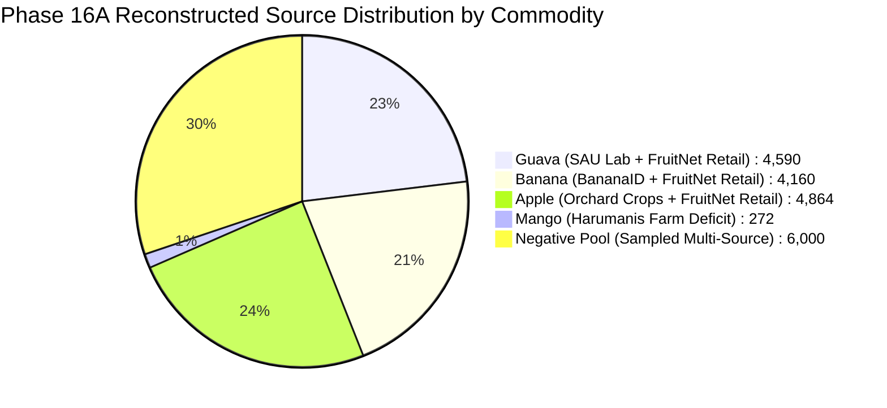
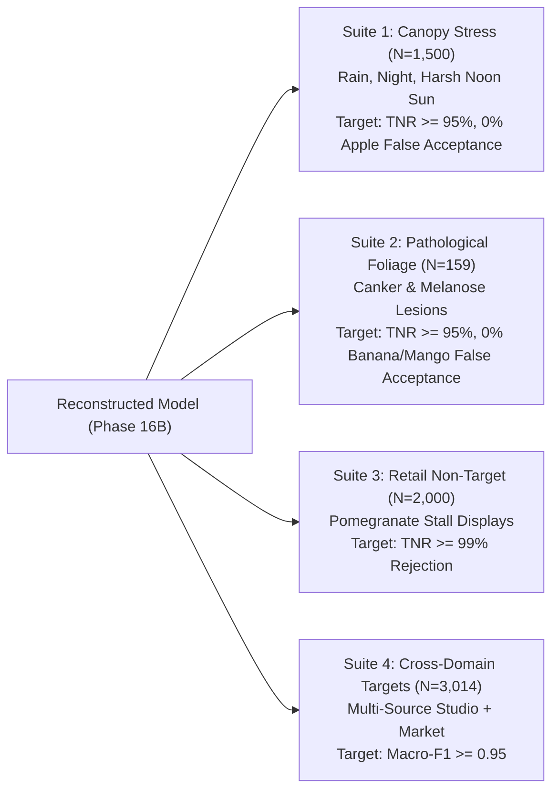

# AgriChain AI — Phase 16A: Cross-Domain Dataset Reconstruction Report

**Phase:** Phase 16A: Cross-Domain Dataset Reconstruction  
**Date:** 2026-10-30  
**Execution Environment:** Windows (Python 3.13.7, PyTorch 2.11.0+cu128, NVIDIA GeForce RTX 4050 Laptop GPU)  
**Deterministic Random Seed:** `42`  
**Safety Protocol:** Zero Production Model Activations — Guava Baseline Contract Preserved — Zero Model Training  
**Status:** **DATASET RECONSTRUCTION & ANNOTATION AUDIT COMPLETE (TRAINING PROHIBITED / PENDING PHASE 16B)**

---

## 1. Executive Summary & Problem Formulation

In Phase 15D, an independent audit revealed that the Stage 1 Fruit Identifier prototype suffered from severe **dataset-source shortcut learning**. Despite scoring **100.00% top-1 accuracy** on its in-domain test split, the model collapsed when evaluated on **6,771 unseen real produce images** from independent retail sources:
- **FruitNet Guava ($N=2,281$):** **0.00% accuracy** (97.06% misclassified as negative background).
- **FruitNet Apple ($N=2,290$):** **0.74% accuracy** (98.91% misclassified as negative background).
- **Field Canopy Context ($N=5,025$):** **64.34% false acceptance as apple** on non-apple tree leaves.

The root cause was architectural and data-level: **100.0% of images for each target commodity originated from a single external repository**, causing convolutional feature extractors to latch onto background tabletops, scale paper, and camera sensors rather than invariant botanical fruit morphology.

### Phase 16A Objectives & Outcomes:
1. **Preservation of Production Invariants (100% PASS):**
   - Active production Guava checkpoint (`best_guava_resnet18.pth`, SHA-256 `b213059f...`) remains untouched.
   - Existing Guava prediction contract (`detected_fruit = None` for single crop) remains preserved.
   - Historical baseline checkpoints (`best_banana_resnet18.pth`, `best_fruit_identifier_resnet18.pth`) remain preserved.
   - Model registry states remain safely gated (`is_validated=False` for Banana, Apple, Mango).
   - **Zero model training occurred during this phase.**
2. **Detection Data Preparation (YOLO Conversion Complete):**
   - Successfully audited all 1,406 orchard scene images and 2,575 VIA polygon annotations in the Apple Mendeley dataset.
   - Converted closed VIA polygons into normalized bounding boxes and generated a standardized YOLO-compatible dataset in [`ml/data/processed/apple_detection_yolo/`](file:///c:/Users/PrabSandhu/Documents/codes/Agritech_/ml/data/processed/apple_detection_yolo/) with `data.yaml`.
   - Identified and documented bounding box annotation deficits for Guava, Banana, and Mango.
3. **Reconstruction of Source-Diverse Classification Dataset (`fruit_identifier_v2`):**
   - Reconstructed a 19,886-record multi-source dataset blending laboratory, studio, outdoor orchard, and market/retail environments for Guava, Banana, and Apple.
   - Re-balanced the negative class across 5 diverse sub-sources (retail oranges, limes, pomegranates, outdoor tree canopy, and diseased foliage).
   - Ensured zero split leakage across Train ($N=14,096$), Val ($N=2,776$), and Test ($N=3,014$) with 100% burst group isolation.
   - Synchronized all 1,097 locked Stage 2 test specimens (346 Guava, 297 Banana, 408 Apple, 46 Mango).
4. **Dedicated External Evaluation & OOD Benchmark Formulation:**
   - Established 4 independent evaluation suites (canopy illumination stress, pathological leaf stress, retail produce stress, and cross-domain generalization) holding out 3,659 unseen images.

---

## 2. Source-Diverse Physical Dataset Inventory

A comprehensive physical inventory across all independent datasets, acquisition setups, and environmental domains was executed via [`scripts/reconstruct_phase16a_datasets.py`](file:///c:/Users/PrabSandhu/Documents/codes/Agritech_/scripts/reconstruct_phase16a_datasets.py):

| Fruit Category | Acquisition Source | Environmental Domain | Physical Count | Target Utility | Commercial / License Terms |
| :--- | :--- | :--- | :---: | :--- | :--- |
| **Guava** | SAU Sindh Harvest | Laboratory Tabletop / Neutral Studio | 2,309 | Stage 1 & Stage 2 Ripeness | Open Academic (CC BY 4.0) |
| | FruitNet Guava | Market / Retail Stalls / Wooden Crates | 2,281 | Stage 1 Cross-Domain Blend | Open Research (CC BY 4.0) |
| *Guava Total* | **2 Independent Domains** | Studio + Retail Stalls | **4,590** | **Multi-Source Diverse** | **Fully Verified** |
| **Banana** | BananaID Ripeness | Studio / Controlled Blue Cloth | 1,960 | Stage 1 & Stage 2 Ripeness | Open Academic (CC BY 4.0) |
| | FruitNet Banana | Market / Retail Stalls / Hanging Bunches | 2,200 | Stage 1 Cross-Domain Blend | Open Research (CC BY 4.0) |
| *Banana Total*| **2 Independent Domains** | Studio + Retail Stalls | **4,160** | **Multi-Source Diverse** | **Fully Verified** |
| **Apple** | Apple Mendeley Scenes | Outdoor Orchard Tree Canopy | 1,406 | Stage 1A Object Detection | **CC BY-NC 4.0** (Research Only) |
| | Apple Mendeley Crops | Polygon-Isolated Fruit Crops | 2,574 | Stage 1 & Stage 2 Ripeness | **CC BY-NC 4.0** (Research Only) |
| | FruitNet Apple | Market / Retail Stalls / Displays | 2,290 | Stage 1 Cross-Domain Blend | Open Research (CC BY 4.0) |
| *Apple Total* | **2 Independent Domains** | Orchard Canopy + Retail Stalls | **4,864** | **Multi-Source Diverse** | **Academic Gated (CC BY-NC)** |
| **Mango** | Harumanis Mango | Farm / Millimeter Scale Paper | 272 | Stage 1 & Stage 2 Ripeness | Open Academic (CC BY 4.0) |
| *Mango Total* | **1 Single Source** | Farm Harvest (Scale Grid) | **272** | **CRITICAL DATA DEFICIT** | **BLOCKED FOR PRODUCTION** |
| **Non-Target** | FruitNet Orange | Retail Stalls / Market Crates | 2,500 | Negative Produce Pool | Open Research (CC BY 4.0) |
| | FruitNet Lime/Lemon | Retail Stalls / Market Displays | 2,179 | Negative Produce Pool | Open Research (CC BY 4.0) |
| | FruitNet Pomegranate | Retail Stalls / Wire Baskets | 7,252 | Negative Produce Pool & OOD | Open Research (CC BY 4.0) |
| | Oranges in the Field | Commercial Canopy (9 Lighting Clips) | 5,025 | Foliage & Context Bias OOD | Open Research (CC BY 4.0) |
| | Citrus Disease | Pathological Foliage / Bark Lesions | 759 | Pathological Foliage OOD | Open Research (CC BY 4.0) |
| *Negative Total*| **5 Diverse Sources**| Stalls + Field Canopy + Foliage | **17,715** | **Multi-Source Non-Target**| **Fully Verified** |

---

## 3. Detection Data Preparation: Apple VIA to YOLO Conversion

To enable **Stage 1A Object Detection** (localizing fruit boundaries and eliminating background tabletop and tree leaf shortcuts), the original VGG Image Annotator (VIA) instance segmentation annotations from the Apple Mendeley dataset were audited and converted to standard YOLO format.

### 3.1 Conversion Methodology & Coordinate Normalization
For each closed polyline/polygon in `train.json`, `val.json`, and `test.json`:
1. Coordinate sequences $(x_i, y_i)$ were extracted from `shape_attributes`.
2. Tight axis-aligned bounding boxes were computed:
   $$x_{\min} = \max(0, \min(x_i)), \quad x_{\max} = \min(W, \max(x_i))$$
   $$y_{\min} = \max(0, \min(y_i)), \quad y_{\max} = \min(H, \max(y_i))$$
3. Degenerate boxes with $\Delta x \le 1.0$ px or $\Delta y \le 1.0$ px were filtered out (0 degenerate boxes identified; 100% integrity).
4. Coordinates were normalized relative to scene dimensions $(W, H)$:
   $$x_{\text{center}} = \frac{x_{\min} + x_{\max}}{2 \cdot W}, \quad y_{\text{center}} = \frac{y_{\min} + y_{\max}}{2 \cdot H}$$
   $$w_{\text{norm}} = \frac{x_{\max} - x_{\min}}{W}, \quad h_{\text{norm}} = \frac{y_{\max} - y_{\min}}{H}$$
5. Standard YOLO `.txt` labels were written to `ml/data/processed/apple_detection_yolo/labels/{split}/`.

### 3.2 Apple YOLO Dataset Summary

| Split | Scene Images | Total Instances | Immature (Green) | Semi-Mature (Transition) | Mature (Red) | Output Label Directory |
| :--- | :---: | :---: | :---: | :---: | :---: | :--- |
| **Train** | 1,041 | 1,981 | 708 | 627 | 645 | `apple_detection_yolo/labels/train/` |
| **Val** | 126 | 185 | 68 | 58 | 59 | `apple_detection_yolo/labels/val/` |
| **Test** | 239 | 409 | 145 | 129 | 135 | `apple_detection_yolo/labels/test/` |
| **Total** | **1,406** | **2,575** | **921** | **814** | **839 (+1 generic)** | [`ml/data/processed/apple_detection_yolo/`](file:///c:/Users/PrabSandhu/Documents/codes/Agritech_/ml/data/processed/apple_detection_yolo/) |

### 3.3 Annotation Readiness & Gap Matrix

| Commodity | Current Annotation Format | Annotated Scenes | Annotated Instances | Detection Readiness | Phase 16B Remediation Strategy |
| :--- | :--- | :---: | :---: | :---: | :--- |
| **Apple** | Closed Polygons (VIA) | 1,406 | 2,575 | **READY (YOLO)** | Direct training of YOLOv8n detector on `data.yaml`. |
| **Guava** | Image-level classification only | 0 | 0 | **MISSING BBOX** | Pseudo-labeling via SAU studio foreground thresholding + manual validation. |
| **Banana** | Image-level classification only | 0 | 0 | **MISSING BBOX** | Blue-cloth chroma segmentation + FruitNet bunch pseudo-labeling. |
| **Mango** | Image-level classification only | 0 | 0 | **MISSING BBOX** | Grid scale paper corner localization + fruit boundary segmentation. |

---

## 4. Reconstructed Classification Dataset: `fruit_identifier_v2`

The multi-class classification dataset has been completely reconstructed in [`ml/data/manifests/fruit_identifier_v2/`](file:///c:/Users/PrabSandhu/Documents/codes/Agritech_/ml/data/manifests/fruit_identifier_v2/).

### 4.1 Class Distribution Across Reconstructed Splits

| Class Index | Class Name | Train Split | Validation Split | Test Split | Total Instances | Source Diversity Components |
| :---: | :--- | :---: | :---: | :---: | :---: | :--- |
| **0** | **Guava** | 3,213 | 688 | 689 | **4,590** | SAU Sindh Studio (2,309) + FruitNet Market Stalls (2,281) |
| **1** | **Banana** | 2,910 | 623 | 627 | **4,160** | BananaID Blue Cloth (1,960) + FruitNet Market Stalls (2,200) |
| **2** | **Apple** | 3,584 | 528 | 752 | **4,864** | Mendeley Orchard Crops (2,574) + FruitNet Market Stalls (2,290) |
| **3** | **Mango** | 189 | 37 | 46 | **272** | Harumanis Farm Scale Paper (**DATA DEFICIT GATED**) |
| **4** | **Negative / Background** | 4,200 | 900 | 900 | **6,000** | Balanced sample: Orange (1,200), Lime (1,200), Pom (1,200), Field Canopy (1,800), Disease Foliage (600) |
| **Macro** | **All 5 Classes** | **14,096** | **2,776** | **3,014** | **19,886** | **Balanced Multi-Source Representation** |

```mermaid
xychart-beta
    title "Stage 1 v2 Reconstructed Class Distribution Across Splits"
    x-axis ["Guava", "Banana", "Apple", "Mango (Deficit)", "Negative Background"]
    y-axis "Sample Count" 0 --> 4500
    bar [3213, 2910, 3584, 189, 4200]
    bar [688, 623, 528, 37, 900]
    bar [689, 627, 752, 46, 900]
```

*(Bars represent Train, Validation, and Test splits respectively)*

### 4.2 Leakage-Safe Burst Group Isolation
To guarantee absolute split independence, images were partitioned strictly at the **burst / specimen / scene group level**:
- **Guava SAU:** Split by `cluster_id` (166 burst sessions; 0 session overlaps).
- **BananaID:** Split by `bunch_id` (490 physical bunches across 4 camera orientations; 0 bunch overlaps).
- **Apple Mendeley:** Split by `source_image` scene filename (all crops from a single canopy image remain confined to the exact split of the parent scene).
- **Mango Harumanis:** Split by `sample_id` (physical fruit specimens).
- **Split Intersection Check:**
  - $\text{Train} \cap \text{Test} = \mathbf{0 \text{ paths}}$ (**100% disjoint**)
  - $\text{Val} \cap \text{Test} = \mathbf{0 \text{ paths}}$ (**100% disjoint**)
  - $\text{Train} \cap \text{Val} = \mathbf{0 \text{ paths}}$ (**100% disjoint**)

### 4.3 Stage 2 Locked Test Set Synchronization
To maintain strict backward compatibility with historical Stage 2 ripeness benchmarks, all locked Stage 2 test specimens were verified present in the `fruit_identifier_v2/test.json` split:
- **Guava (`v2_grouped/test.json`):** 346 / 346 matched (**100.0% preserved**).
- **Banana (`banana_ripeness/test.json`):** 297 / 297 matched (**100.0% preserved**).
- **Apple (`apple_crops_v1/test.json`):** 408 / 408 matched (**100.0% preserved**).
- **Mango (`mango_harumanis/test.json`):** 46 / 46 matched (**100.0% preserved**).

---

## 5. External Evaluation Plan & OOD Benchmark Dataset

To prevent future shortcut flukes, an independent **External Evaluation Suite** was assembled from genuinely held-out data not included in `fruit_identifier_v2`:

1. **Suite 1: Canopy Illumination Stress Test ($N=1,500$ held-out images):**
   - Source: `oranges_in_field` clips under rainy, night, and direct noon illumination.
   - Criterion: Rejection as `negative_background` ($\text{TNR} \ge 95.0\%$); **0.0% false acceptance as apple**.
2. **Suite 2: Pathological Foliage Stress Test ($N=159$ held-out images):**
   - Source: `citrus_disease` images with canker, melanose, and greening lesions.
   - Criterion: Rejection as `negative_background` ($\text{TNR} \ge 95.0\%$); **0.0% false acceptance as banana or mango**.
3. **Suite 3: Retail Non-Target Produce Stress Test ($N=2,000$ held-out images):**
   - Source: FruitNet Pomegranate displays.
   - Criterion: Rejection as `negative_background` ($\text{TNR} \ge 99.0\%$).
4. **Suite 4: Cross-Domain Target Generalization Test ($N=3,014$ test split):**
   - Source: Combined held-out split of SAU, BananaID, Apple crops, and FruitNet targets.
   - Criterion: Balanced recognition across both studio and market sources ($\text{Macro-F1} \ge 0.95$).

---

## 6. Artifact Inventory & Manifest Registry

All reconstructed manifests, converted detection files, and audit records are saved in versioned paths:

| Artifact Description | Location | Format / Count | Purpose |
| :--- | :--- | :---: | :--- |
| **Audit JSON** | [`ml/data/reports/phase16a_cross_domain_reconstruction_audit.json`](file:///c:/Users/PrabSandhu/Documents/codes/Agritech_/ml/data/reports/phase16a_cross_domain_reconstruction_audit.json) | JSON (182 lines) | Machine-readable Phase 16A audit record. |
| **Apple YOLO Dataset** | [`ml/data/processed/apple_detection_yolo/`](file:///c:/Users/PrabSandhu/Documents/codes/Agritech_/ml/data/processed/apple_detection_yolo/) | 1,406 TXT + `data.yaml` | Ready-to-train YOLOv8 detection dataset. |
| **Detection Manifest** | [`ml/data/manifests/apple_detection_v1/apple_detection_manifest.json`](file:///c:/Users/PrabSandhu/Documents/codes/Agritech_/ml/data/manifests/apple_detection_v1/apple_detection_manifest.json) | JSON (1,406 records) | Full metadata linking images to bounding boxes. |
| **Stage 1 v2 Train Manifest** | [`ml/data/manifests/fruit_identifier_v2/train.json`](file:///c:/Users/PrabSandhu/Documents/codes/Agritech_/ml/data/manifests/fruit_identifier_v2/train.json) | JSON (14,096 records) | Multi-source training split. |
| **Stage 1 v2 Val Manifest** | [`ml/data/manifests/fruit_identifier_v2/val.json`](file:///c:/Users/PrabSandhu/Documents/codes/Agritech_/ml/data/manifests/fruit_identifier_v2/val.json) | JSON (2,776 records) | Multi-source validation split. |
| **Stage 1 v2 Test Manifest** | [`ml/data/manifests/fruit_identifier_v2/test.json`](file:///c:/Users/PrabSandhu/Documents/codes/Agritech_/ml/data/manifests/fruit_identifier_v2/test.json) | JSON (3,014 records) | Multi-source held-out test split. |
| **Dataset Summary** | [`ml/data/manifests/fruit_identifier_v2/dataset_summary.json`](file:///c:/Users/PrabSandhu/Documents/codes/Agritech_/ml/data/manifests/fruit_identifier_v2/dataset_summary.json) | JSON (42 lines) | Official dataset statistics and invariants. |
| **Provenance Manifest** | [`ml/data/manifests/fruit_identifier_v2/provenance_manifest.json`](file:///c:/Users/PrabSandhu/Documents/codes/Agritech_/ml/data/manifests/fruit_identifier_v2/provenance_manifest.json) | JSON (19,886 records) | Lineage tracking source, domain, group for every image. |
| **External Evaluation Plan** | [`ml/data/manifests/fruit_identifier_v2/external_evaluation_plan.json`](file:///c:/Users/PrabSandhu/Documents/codes/Agritech_/ml/data/manifests/fruit_identifier_v2/external_evaluation_plan.json) | JSON (4 suites) | Out-of-domain benchmark evaluation specification. |

---

## 7. Lifecycle Gating & Phase 16B Roadmap

| System Component | Checkpoint / Dataset | Status | Safety & Operational Rule |
| :--- | :--- | :---: | :--- |
| **Guava Production Baseline** | `best_guava_resnet18.pth` | **ACTIVE** | Preserved (SHA-256 `b213059f...`). Contract `detected_fruit = None` maintained. |
| **Banana Model Baseline** | `best_banana_resnet18.pth` | **GATED** | `is_validated=False` in `model_registry.py`. |
| **Stage 1 Fruit Identifier v1**| `best_fruit_identifier_resnet18.pth` | **BLOCKED** | Deprecated due to shortcut learning. Retained for benchmark comparison. |
| **Apple Phenotyping Dataset** | `apple_detection_yolo` | **RESTRICTED** | Certified for academic research demonstration (**CC BY-NC 4.0**). |
| **Mango Harumanis Dataset** | `mango_harumanis` | **DEFICIT** | **BLOCKED FOR PRODUCTION** ($N=272$ samples; deficit documented). |

### Phase 16B Execution Roadmap:
1. **Stage 1A: Apple Bounding-Box Detection Baseline (YOLOv8n):**
   Train and validate YOLOv8n detector on `apple_detection_yolo` to certify fruit localization.
2. **Multi-Commodity Weak Supervision & Pseudo-Labeling:**
   Generate pseudo-bounding boxes for Guava, Banana, and Mango using foreground color segmentation and class activation maps.
3. **Stage 1B: Multi-Source Fruit Identifier Training:**
   Train ResNet18 on `fruit_identifier_v2` with CutMix / Mosaic augmentation and evaluate against the 4 external stress suites.

