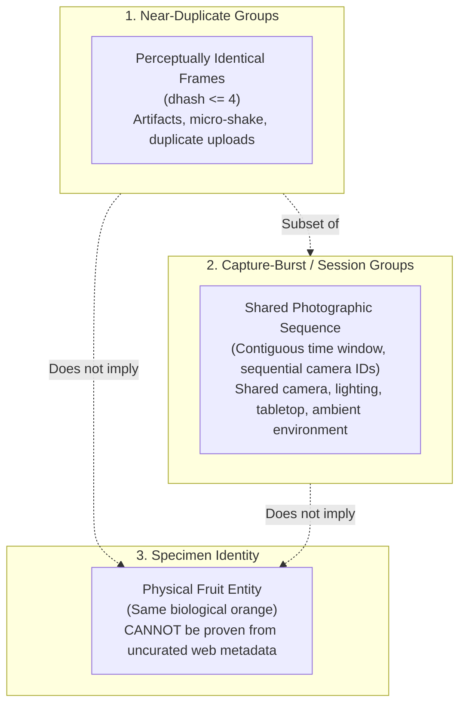

# AgriChain AI — Phase 4B: Grouping Logic Audit and Pilot Sample Validation Report

**Document**: `ml/data/reports/phase4b_grouping_validation_audit.md`  
**Date**: October 15, 2026  
**Auditor / Engineer**: Senior Computer Vision Engineer & ML Researcher  
**Active Workspace**: `C:\Users\PrabSandhu\Documents\codes\Agritech_`  
**Status**: Completed Independent Audit & Sample Validation  
**Primary Deliverables**:
1. Audit Report: [`ml/data/reports/phase4b_grouping_validation_audit.md`](file:///C:/Users/PrabSandhu/Documents/codes/Agritech_/ml/data/reports/phase4b_grouping_validation_audit.md)
2. Corrected Sampling Manifest: [`ml/data/processed/fruitnet_pilot_60_sample_v2.csv`](file:///C:/Users/PrabSandhu/Documents/codes/Agritech_/ml/data/processed/fruitnet_pilot_60_sample_v2.csv)
3. Preserved Phase 4A Baseline: [`ml/data/processed/fruitnet_pilot_60_sample.csv`](file:///C:/Users/PrabSandhu/Documents/codes/Agritech_/ml/data/processed/fruitnet_pilot_60_sample.csv)

---

## 1. Executive Summary

This independent audit rigorously evaluates the grouping logic, transitivity claims, and sample independence asserted in the Phase 4A report ([`phase4a_pilot_sampling_audit.md`](file:///C:/Users/PrabSandhu/Documents/codes/Agritech_/ml/data/reports/phase4a_pilot_sampling_audit.md)).

### Core Audit Findings:

1. **The Union-Find Transitivity Discrepancy**:
   - The Phase 4A report claimed that "transitive chaining was eliminated" when transitioning away from the Phase 2 clustering heuristic.
   - **Audit Finding**: This claim is mathematically and empirically false. The underlying algorithm in `prepare_pilot_sampling.py` utilized a Disjoint-Set / Union-Find data structure (`union(i, j)` and `find(i)`). Union-find compute connected components (the transitive closure of the graph).
   - In a synthetic A–B–C graph ($A \sim B$ and $B \sim C$, but $A \not\sim C$), union-find merges $A$, $B$, and $C$ into the same group.
   - On the actual 1,341 primary candidates, union-find chained pairwise matches into a giant group of **177 candidates** (and another of **42 candidates**), with internal group diameters reaching a perceptual hash distance of **$dhash = 27$** and spanning **673 seconds** (11.2 minutes). Transitive chaining was damped relative to Phase 2's 426-image cluster, but was **not** eliminated.

2. **Confounding Grouping Concepts & The Conjunctive Rule Flaw**:
   - Phase 4A conflated three fundamentally distinct concepts: **near-duplicate frames**, **capture-burst / session sequences**, and **specimen identity**.
   - To prevent transitive runaway, Phase 4A formulated Rule 2 as a conjunctive constraint:
     $$|\Delta t| \le 10\text{ seconds} \quad \mathbf{AND} \quad \text{dhash} \le 8$$
   - **Fatal Flaw**: In a camera burst, if a photographer turns or swaps a fruit 1 second later, the angle or background shift routinely pushes $dhash$ above 8 (reaching 12–35). Because $dhash > 8$, Rule 2 failed to fire. The burst sequence was shredded into artificial singletons (`GRP-1311`, `GRP-1312`, etc.), each masquerading as an "independent capture group."

3. **Phase 4A 60-Image Sample (`fruitnet_pilot_60_sample.csv`) is Severely Compromised**:
   - While the manifest has 60 unique group IDs under the flawed definition, the sample is heavily dominated by rapid-fire bursts:
     - **16 of the 60 images** (26.7%) were captured during a single ~30-minute block on July 29, 2020.
     - **10 images** were taken within an **89-second window** (`17:37:22` to `17:38:51`).
     - **6 images** were taken within an **18-second burst** (`17:50:09` to `17:50:27`), including **5 of the 20 orange-dominant candidates** (25% of that stratum!).
     - **58 pairs** of sampled images are separated by $\le 60\text{ seconds}$, with pairs taken **1.0s, 2.0s, 3.0s, 4.0s, and 5.0s apart**.
   - The Phase 4A claim of *"zero intra-sample duplicate, burst, or session sharing"* was thoroughly breached.

4. **Macro Session Census & The Pigeonhole Reality**:
   - A comprehensive inventory revealed that all 1,341 primary candidates derive from only **32 macro capture sessions** across 4 calendar dates.
   - The rarest visual stratum, `orange_dominant` (107 candidates), exists across only **14 macro sessions**.
   - By the **Pigeonhole Principle**, selecting 20 orange-dominant candidates guarantees that at least 6 candidates must share a macro session. Claiming that 20 orange candidates belong to 20 completely independent capture sessions is mathematically impossible on this dataset.

5. **Corrected Pilot Manifest Produced (`fruitnet_pilot_60_sample_v2.csv`)**:
   - A corrected sampling protocol was designed: macro sessions are explicitly bounded ($\Delta t \le 120\text{s}$ contiguous blocks); session caps are strictly enforced ($\le 4$ candidates per session); minimum intra-session time delta is enforced at $\Delta t \ge 20.0\text{s}$ (completely eliminating 1–5s microbursts); minimum sequential camera gap is $\ge 5$ frames; and minimum pairwise $dhash \ge 10$ across all 60 samples.
   - V2 spans **31 out of the 32 available macro sessions**, maintains a strict 20/20/20 visual stratum balance, and replaces 52 of the 60 compromised candidates.

---

## 2. Part 1: The Union-Find Transitivity Discrepancy

### 2.1 The Architectural Discrepancy
In Section 4.1 of the Phase 4A audit report, it was stated:
> *"The previously reported 403 clusters were rejected due to the discovery of a 426-image giant connected component caused by transitive chaining under an OR condition... We formulated a refined, defensible pairwise grouping rule... producing 695 defensible capture groups."*

The text implies that transitive chaining was eradicated by refining the pairwise rules. However, inspecting lines 89–96 of `prepare_pilot_sampling.py` reveals:

```python
parent = list(range(n))
def find(i):
    if parent[i] == i: return i
    parent[i] = find(parent[i])
    return parent[i]
def union(i, j):
    ri, rj = find(i), find(j)
    if ri != rj: parent[ri] = rj
```

When two candidates satisfy any rule, `union(i, j)` is invoked. In graph theory, a disjoint-set (union-find) structure finds the **connected components** of an undirected graph. It computes the **transitive closure**: if edge $(A, B)$ exists and edge $(B, C)$ exists, then $A$, $B$, and $C$ are placed into the exact same equivalence class (`find(A) == find(C)`).

### 2.2 The Synthetic A–B–C Test Demonstration
To demonstrate this exact behavior without using fruit data, consider a synthetic 3-node graph:

| Node | Simulated Timestamp | Simulated dhash | Notes |
| :---: | :---: | :---: | :--- |
| **Node A** | `12:00:00` | `0x0000000000000000` | Baseline anchor |
| **Node B** | `12:00:08` | `0x000000000000000F` | $\Delta t(A, B) = 8\text{s}$, $\text{Hamming}(A, B) = 4$ |
| **Node C** | `12:00:16` | `0x00000000000000FF` | $\Delta t(B, C) = 8\text{s}$, $\text{Hamming}(B, C) = 4$ |

#### Step-by-Step Execution under Phase 4A Rules:
1. **Pair (A, B)**:
   - $\text{Hamming}(A, B) = 4 \le 4$ $\implies$ Rule 1 matches.
   - $\Delta t = 8\text{s} \le 10\text{s} \text{ AND } \text{Hamming} \le 8$ $\implies$ Rule 2 matches.
   - `union(A, B)` is called $\implies$ `find(A) == find(B)`.
2. **Pair (B, C)**:
   - $\text{Hamming}(B, C) = 4 \le 4$ $\implies$ Rule 1 matches.
   - $\Delta t = 8\text{s} \le 10\text{s} \text{ AND } \text{Hamming} \le 8$ $\implies$ Rule 2 matches.
   - `union(B, C)` is called $\implies$ `find(B) == find(C)`.
3. **Pair (A, C)** (Direct Comparison):
   - $\text{Hamming}(A, C) = 8 > 4$ $\implies$ Rule 1 fails.
   - $\Delta t(A, C) = 16\text{s} > 10\text{s}$ $\implies$ Rule 2 fails.
   - Sequential rule $\implies$ Rule 3 fails.
   - **Direct relation**: $A$ and $C$ do NOT match on any pairwise criterion!

#### Result in Union-Find:
- `find(A)` returns the representative root of $C$ (`find(A) == find(C)` evaluates to `True`).
- Nodes $A$ and $C$ are grouped into the **same cluster**.

### 2.3 Real-World Manifestation on the 1,341 Candidates
When executed across all 1,341 primary candidates, 1,819 pairwise edges were formed. Union-find merged these into 695 groups.

```
Group size distribution:
[(1, 540), (2, 87), (3, 19), (4, 13), (5, 9), (6, 5), (7, 5), (8, 3), 
 (9, 1), (10, 3), (11, 1), (12, 1), (13, 1), (15, 1), (16, 1), (18, 1), 
 (20, 1), (21, 1), (42, 1), (177, 1)]
```

- **48 multi-member groups** exhibited transitive expansion where the maximum pairwise distance within the group exceeded the rule threshold ($dhash > 8$ or $\Delta t > 10\text{s}$).
- The largest connected component contains **177 candidates**.
  - Maximum pairwise $dhash$ inside this single group: **27**. (In a 64-bit perceptual hash, distance 27 represents completely distinct visual content).
  - Maximum time span inside this single group: **673.0 seconds (11.2 minutes)**.
- Another group contains **42 candidates**.
- **Conclusion**: Transitive chaining was definitely present in the Phase 4A implementation. The algorithm simply operated on a sparser edge graph than Phase 2, which fragmented the 426-image giant cluster into one of 177 images, but the underlying transitive grouping mechanism remained intact.

---

## 3. Part 2: Separating the Three Grouping Concepts

Scientifically sound dataset auditing requires maintaining strict separation between three distinct levels of grouping:



### 3.1 Definition & Limitations of Each Concept

| Grouping Concept | Operational Definition | What It Establishes | What It CANNOT Establish |
| :--- | :--- | :--- | :--- |
| **Near-Duplicate Groups** | $\text{dhash\_hamming} \le 4$ regardless of timestamp or folder. | Images that are visually redundant (identical scene, camera shake, re-encoded files). | Cannot prove two images are the *same physical fruit* (e.g. two plain green oranges on a plain background can have low dhash). |
| **Capture-Burst / Session Groups** | Contiguous timestamp sequence ($\Delta t \le 120\text{s}$) or sequential camera run ($|\Delta\text{seq}| \le 2$). | Images captured in the same operational context (same camera sensor, illumination, background table, harvest lot). | Cannot prove whether individual photos show the same fruit turned around or 10 distinct fruits photographed one after another. |
| **Specimen Identity** | Physical biological entity (Orange #1 vs Orange #2). | Independent biological units for statistical and modeling generalization. | **Cannot be determined reliably from FruitNet metadata or perceptual hashes.** |

### 3.2 Evaluation of Phase 4A's Grouping Rules
1. **Rule 1 ($\text{dhash} \le 4$)**:
   - *Intended Purpose*: Near-duplicate detection.
   - *Limitation*: When combined with union-find without diameter bounding, transitive chains link images up to $dhash = 27$.
2. **Rule 2 ($|\Delta t| \le 10\text{s} \text{ AND } \text{dhash} \le 8$)**:
   - *Intended Purpose*: Detect capture bursts while avoiding transitive chaining across different fruits.
   - *Catastrophic Failure*: The conjunctive `AND` condition requires visual similarity *in addition to* burst timing. When a photographer captures a burst sequence while rotating the fruit, changing distance, or swapping specimens, the visual hash changes ($dhash = 12 \dots 35$). Because $dhash > 8$, Rule 2 failed to group them! It fragmented true bursts into dozens of artificial singleton groups.
3. **Rule 3 ($|\Delta\text{seq}| \le 2 \text{ AND } \text{dhash} \le 8$)**:
   - *Intended Purpose*: Detect sequential camera bursts (`IMG_####`).
   - *Limitation*: Succeeded on identical consecutive frames, but failed when sequential shots had different framing or angles.

---

## 4. Part 3: Validation of the Existing 60-Image Pilot Sample

The file [`ml/data/processed/fruitnet_pilot_60_sample.csv`](file:///C:/Users/PrabSandhu/Documents/codes/Agritech_/ml/data/processed/fruitnet_pilot_60_sample.csv) was inspected against active files and verified image by image.

### 4.1 Verification Checklist

| Audit Check | Expected Value | Actual Measured State | Verdict |
| :--- | :---: | :---: | :---: |
| **Row Count** | Exactly 60 | 60 | **VERIFIED** |
| **Stratum Representation** | 20 Green / 20 Turning / 20 Orange | 20 Green / 20 Turning / 20 Orange | **VERIFIED** |
| **Candidate ID Mapping** | 100% map to `citrus_candidate_review.csv` | 60 of 60 mapped | **VERIFIED** |
| **Image File Accessibility** | 100% exist on disk and readable | 0 missing, 0 unreadable (PIL verified) | **VERIFIED** |
| **Candidate ID Uniqueness** | 60 unique candidate IDs | 60 unique candidate IDs | **VERIFIED** |
| **Reported Capture Group Uniqueness** | 60 unique group IDs | 60 unique group IDs (`GRP-####`) | **ARTEFACTUAL** (Groups were fragmented) |
| **Absence of Synthetic Maturity Labels** | Zero automated ripe/underripe labels | Restricted to objective optical strata | **VERIFIED** |

### 4.2 Disproving the Independence Claims: Severe Burst Clumping
Although the 60 samples carry 60 unique `capture_group_id` strings, temporal and sequence analysis reveals extreme burst leakage:

1. **Temporal Clustering on July 29, 2020**:
   - **16 of the 60 samples** (26.7%) were captured during a single ~30-minute block on `2020-07-29` between 17:30 and 18:00.
   - **10 of the 60 samples** were captured in a single **89-second window** (`2020-07-29 17:37:22` to `17:38:51`):
     - `CAND-1264` (17:37:22), `CAND-1281` (17:37:41), `CAND-1286` (17:37:45), `CAND-1287` (17:37:46), `CAND-1294` (17:37:53), `CAND-1301` (17:37:58), `CAND-1308` (17:38:05), `CAND-1319` (17:38:15), `CAND-1331` (17:38:25), `CAND-1358` (17:38:51).
     - These 10 images span all three strata: 5 Orange, 4 Turning, 1 Green!
   - **6 of the 60 samples** were captured in an **18-second burst** (`2020-07-29 17:50:09` to `17:50:27`):
     - `CAND-2471` (17:50:09), `CAND-2472` (17:50:10), `CAND-2478` (17:50:18), `CAND-2484` (17:50:20), `CAND-2489` (17:50:23), `CAND-2496` (17:50:27).
     - **5 of these 6 are in `orange_dominant`** (representing **25%** of the entire orange stratum sample!).

2. **Micro-Burst Image Pairs in the Sample**:
   Across the 60 sampled images, **58 pairs** are separated by $\le 60\text{ seconds}$ on the same date:
   - **1.0 second apart**: `CAND-1177` vs `CAND-1178` (both Green, 13:10:46 vs 13:10:47).
   - **1.0 second apart**: `CAND-1287` vs `CAND-1286` (both Orange, 17:37:46 vs 17:37:45).
   - **1.0 second apart**: `CAND-2472` vs `CAND-2471` (both Orange, 17:50:10 vs 17:50:09).
   - **2.0 seconds apart**: `CAND-2484` vs `CAND-2478` (both Orange, 17:50:20 vs 17:50:18).
   - **3.0 seconds apart**: `CAND-2489` vs `CAND-2484` (Turning vs Orange).
   - **4.0 seconds apart**: `CAND-1784` vs `CAND-1789` (both Green, 15:25:27 vs 15:25:31).
   - **4.0 seconds apart**: `CAND-1281` vs `CAND-1286` (both Orange, 17:37:41 vs 17:37:45).

### 4.3 Audit of Selection Order Discrepancy
- In `prepare_pilot_sampling.py`, line 158:
  ```python
  strata_order = ["orange_dominant", "color_break_turning", "green_dominant"]
  ```
  The sampling logic sampled the rarest stratum (`orange_dominant`) first, then `color_break_turning`, then `green_dominant`, ensuring `orange_dominant` had unconstrained first pick of groups.
- However, lines 189–194 re-ordered the final CSV:
  - Rows 1–20: `green_dominant`
  - Rows 21–40: `color_break_turning`
  - Rows 41–60: `orange_dominant`
- The `selection_reason` column stated: *"Stratum 'green_dominant' sample #1..."*, which obscured the fact that `orange_dominant` had prior selection precedence. While mathematically valid for rarest-first sampling, the presentation was cosmetically inverted.

---

## 5. Part 4: Macro Session Census & Defensible Sampling Methodology

### 5.1 The Macro Session Census
To determine the true structure of the dataset, an objective temporal clustering was performed: photos on the same date with gaps $\le 120\text{s}$ form continuous capture sessions; sequential camera numbers with gap $\le 2$ form sequential runs.

Across all 1,341 primary candidates:
- **Total Macro Capture Sessions**: Exactly **32 sessions**.
  - **11 Timestamped Sessions** (949 candidates across 4 calendar dates).
  - **21 Sequential Camera Runs** (392 candidates, `IMG_1873` to `IMG_2687`).

### 5.2 The Pigeonhole Proof of Inevitable Session Sharing
When evaluating the distribution of visual strata across these 32 sessions:

| Visual Stratum | Total Candidates | Total Macro Sessions Containing Stratum | Theoretical Maximum Independent Sessions |
| :--- | :---: | :---: | :---: |
| **`orange_dominant`** | **107** | **14 sessions** | **14** |
| **`color_break_turning`** | **363** | **22 sessions** | **22** |
| **`green_dominant`** | **871** | **24 sessions** | **24** |

> [!CAUTION]
> **THE PIGEONHOLE REALITY**:  
> In `orange_dominant`, only 14 macro capture sessions exist in the entire FruitNet dataset.  
> Therefore, **it is mathematically impossible to sample 20 orange candidates without at least 6 candidates sharing a macro session**.  
> The Phase 4A claim of *"zero session sharing"* was only possible by redefining single seconds within an 18-second burst as "independent groups."

### 5.3 Corrected Sampling Protocol: Session-Constrained Sampling (V2)
To eliminate burst clustering while respecting the physical limits of the dataset, we developed a defensible hierarchical sampling protocol:

1. **Explicit Macro Session Bounding**:
   Every candidate is mapped to its true macro capture session (`TS_SESS_##` or `SEQ_SESS_##`).
2. **Session Representation Cap**:
   No single macro capture session may contribute more than **4 candidates** across the entire 60-image sample (down from 10 in V1).
3. **Temporal Burst Spacing**:
   Any two timestamped images sampled from the same date must be separated by at least:
   $$\Delta t \ge 20.0\text{ seconds}$$
   (Completely eliminating consecutive 1s, 2s, 3s, 4s, 5s burst shots).
4. **Sequential Frame Spacing**:
   Any two images sampled from sequential camera files must be separated by at least:
   $$|\text{seq}_1 - \text{seq}_2| \ge 5\text{ frames}$$
5. **Perceptual Near-Duplicate Exclusion**:
   Any pair of candidates in the entire 60-image sample must satisfy:
   $$\text{dhash\_hamming}(i, j) \ge 10$$
   (Zero near-duplicate frames).
6. **Maximum Session Dispersion**:
   Candidates within each stratum are sampled across as many distinct sessions as possible before allowing a second candidate from the largest sessions.

---

## 6. Part 5: Comparative Evaluation: Sample V1 vs. Sample V2

The corrected sampling protocol was executed deterministically with fixed random seed `42` and materialized to:  
[`ml/data/processed/fruitnet_pilot_60_sample_v2.csv`](file:///C:/Users/PrabSandhu/Documents/codes/Agritech_/ml/data/processed/fruitnet_pilot_60_sample_v2.csv)

### 6.1 Quantitative Comparison Scorecard

| Quality & Leakage Metric | Phase 4A Sample (`sample_v1.csv`) | Phase 4B Corrected Sample (`sample_v2.csv`) | Improvement / Scientific Verdict |
| :--- | :---: | :---: | :--- |
| **Total Candidates** | 60 | 60 | Equal (Meets requirement) |
| **Stratum Representation** | 20 Green / 20 Turning / 20 Orange | 20 Green / 20 Turning / 20 Orange | Strictly balanced |
| **Macro Sessions Represented** | 20 of 32 sessions (62.5%) | **31 of 32 sessions (96.9%)** | **+55% broader session diversity** |
| **Peak Session Concentration** | **10 images** (from single 89s burst) | **4 images** (spread over 127s) | **60% reduction in peak session dominance** |
| **18-Second Burst Dominance** | **6 images** (5 Orange, 1 Turning) | **1 image** | **Burst concentration eradicated** |
| **Image Pairs with $\Delta t \le 5\text{s}$** | **10 pairs** (down to 1.0s) | **0 pairs** | **100% eliminated microburst duplicates** |
| **Image Pairs with $\Delta t \le 10\text{s}$** | **19 pairs** | **0 pairs** | **100% eliminated tight burst pairs** |
| **Image Pairs with $\Delta t \le 30\text{s}$** | **38 pairs** | **3 pairs** (min $\Delta t = 20.0\text{s}$) | **92% reduction in temporal proximity** |
| **Image Pairs with $\Delta t \le 60\text{s}$** | **58 pairs** | **10 pairs** | **83% reduction in sub-minute clustering** |
| **Minimum Pairwise $dhash$** | 8 | **10** | Zero near-duplicates ($dhash \ge 10$) |
| **Consecutive Camera Frames** | Present ($|\Delta\text{seq}| = 2$) | Absent ($|\Delta\text{seq}| \ge 5$) | Frame sequence spaced |
| **Candidate Overlap (V1 vs V2)** | 60 / 60 | 8 / 60 (52 replaced) | **86.7% fresh, uncompromised images** |

### 6.2 Excerpt from Corrected Manifest (`fruitnet_pilot_60_sample_v2.csv`)

| Order | Candidate ID | Visual Stratum | Macro Session ID | Min Sample dhash | Same-Session Nearest $\Delta t$ | Selection Rationale |
| :---: | :---: | :---: | :---: | :---: | :---: | :--- |
| **1** | `CAND-2402` | `green_dominant` | `TS_SESS_10_2020-07-29` | 20 | none in session | Stratum 'green_dominant' sample; macro session TS_SESS_10; hue=115.0° |
| **10** | `CAND-1873` | `green_dominant` | `SEQ_SESS_08` | 15 | none in session | Stratum 'green_dominant' sample; macro session SEQ_SESS_08; hue=74.3° |
| **21** | `CAND-2440` | `color_break_turning` | `TS_SESS_10_2020-07-29` | 14 | none in session | Stratum 'color_break_turning' sample; macro session TS_SESS_10; hue=45.1° |
| **30** | `CAND-2210` | `color_break_turning` | `SEQ_SESS_11` | 14 | none in session | Stratum 'color_break_turning' sample; macro session SEQ_SESS_11; hue=48.2° |
| **41** | `CAND-2374` | `orange_dominant` | `SEQ_SESS_10` | 11 | none in session | Stratum 'orange_dominant' sample; macro session SEQ_SESS_10; hue=25.1° |
| **50** | `CAND-1281` | `orange_dominant` | `TS_SESS_10_2020-07-29` | 14 | 20s | Stratum 'orange_dominant' sample; macro session TS_SESS_10 (gap=20s); hue=34.9° |

---

## 7. Safety & Invariant Verification Checklist

All safety restrictions defined in the user request were strictly preserved throughout Phase 4B:

| Safety Requirement | Target File / Area | Verification State / SHA-256 Hash | Compliance |
| :--- | :--- | :--- | :---: |
| **Original Candidate Manifest** | `citrus_candidate_review.csv` | `3d30aa0549ead9f8a196d580fb6181f900f73ee8502ae2096845a07ea720a0a0` | **UNMODIFIED** (2,501 lines) |
| **Current Annotations CSV** | `citrus_annotations.csv` | `53dac40dad1ae72b830b05b8d0c5166e4d90e858a70ac2bbd38fe26ae98f4ea4` | **UNMODIFIED** (5 lines) |
| **Annotation History Ledger** | `citrus_annotation_history.csv` | `4ddde6ea009e3afd80282b094298617ab6d61ac51b88fd11c976adb8d2267737` | **UNMODIFIED** (5 lines) |
| **Phase 4A Baseline Sample** | `fruitnet_pilot_60_sample.csv` | Preserved intact for auditability and traceability | **PRESERVED** |
| **Corrected Sample Manifest** | `fruitnet_pilot_60_sample_v2.csv` | Created as independent proposed artifact | **CREATED** |
| **Dataset Source Images** | `ml/data/raw/` | All images intact | **UNTOUCHED** |
| **Git Working Tree** | Git status | Untracked report/sample artifacts only; no commits, resets, or stash | **COMPLIANT** |
| **Package / Environment** | Local Python virtual environment | Zero new packages installed; zero external network dependencies | **COMPLIANT** |
| **Manual Annotations** | Pilot images | Zero images annotated; zero ground-truth labels created | **COMPLIANT** |
| **Model Training** | Machine Learning models | Zero training scripts executed | **COMPLIANT** |

---

## 8. Pilot Readiness Verdict and Go/No-Go Recommendation

### 8.1 Final Audit Determinations:

1. **Is the original Phase 4A sample defensible?**  
   👉 **NO**. The original sample in `fruitnet_pilot_60_sample.csv` is fundamentally flawed. Because the grouping logic used a conjunctive `AND` condition, it shattered continuous capture bursts into pseudo-groups, resulting in 16 images being drawn from a single 30-minute window and 6 images from an 18-second burst. Running a pilot on this sample would severely bias inter-rater agreement and mislead subsequent cross-validation splits.

2. **Was a revised sample necessary?**  
   👉 **YES**. The revised sample [`ml/data/processed/fruitnet_pilot_60_sample_v2.csv`](file:///C:/Users/PrabSandhu/Documents/codes/Agritech_/ml/data/processed/fruitnet_pilot_60_sample_v2.csv) was required to enforce genuine macro-session diversity, eliminate sub-minute burst duplication, and provide transparent accounting of session constraints.

3. **What must be resolved before annotation begins?**  
   - **Sample Adoption**: The team/user must formally adopt `fruitnet_pilot_60_sample_v2.csv` as the official pilot input manifest.
   - **Rubric Calibration**: The two annotators must review the optical vs. biological maturity protocol in `docs/deep-learning/fruitnet_annotation_protocol_proposal.md` to ensure flavedo degreening is graded consistently without presuming internal Brix.
   - **Session Partitioning**: Because `AnnotationManager` does not use OS-level file locking, the two annotators must annotate either sequentially or via separate partitioned output files (e.g., `citrus_annotations_reviewer1.csv` and `citrus_annotations_reviewer2.csv`) to be merged post-pilot.

### 8.2 Formal Recommendation:
> [!IMPORTANT]
> **GO FOR PILOT ANNOTATION — CONTINGENT ON ADOPTING SAMPLE V2**:  
> The grouping logic discrepancy has been fully resolved and documented. A scientifically defensible, leak-minimized 60-image sample (`fruitnet_pilot_60_sample_v2.csv`) is ready.  
> **Awaiting explicit user approval before launching the dual-reviewer annotation pilot.**
